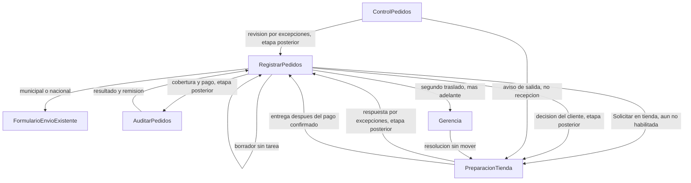

# Fase 2.1 — UX operativa de Tienda

Replanteo de la subfase 2.1.1, 2 de noviembre de 2026. Este texto es la única versión vigente de la captura inicial. Está implementada en la aplicación y pendiente de revisión. La solicitud sigue deshabilitada y el recorrido operativo no está cerrado. No avanza a 2.1.2.

La captura anterior y el prototipo de [docs/visual-refresh/registrar-pedidos-tienda/](docs/visual-refresh/registrar-pedidos-tienda/) pedían cobertura, sucursal o piezas en el alta. Dejan de ser autoridad para este paso. El análisis V02.1 no se reescribió. [PRODUCT.md](PRODUCT.md) todavía dice que el archivo de T-01 no está confirmado; no se edita aquí. Para 2.1.1 prevalece este plan.

Numeración UX, distinta de la fase operativa 2 del plan de rediseño:

- 2.1.1 Registrar pedidos — captura inicial.
- 2.1.2 Control Pedidos.
- 2.1.3 Auditar pedidos.
- 2.1.4 Preparación Tienda.
- 2.1.5 Validación integral y autorizaciones.

## Correspondencia de vistas

Un nombre personal es referencia de rol. No entra como condición de código.

- Vendedora: Registrar pedidos.
- Auxiliar de ventas: Auditar pedidos.
- Auxiliar de tienda: Preparación Tienda.
- CEDIS y empacadores: Control Pedidos.
- Encargado de guías: Entregar guías.

Tienda como modalidad y Preparación Tienda como vista siguen siendo conceptos distintos. Las tareas municipales de esa vista permanecen en su segmento.

## Decisiones que siguen vigentes

- La captura inicial identifica el pedido y puede adjuntar el archivo. No clasifica T-01, no pide cobertura y no transcribe piezas. Para el caso descrito, «Solicitar en tienda» dirige la revisión de disponibilidad y la separación a Preparación Tienda. Esa acción no declara forma de pago y permanece deshabilitada.
- Guardar borrador no exige pago ni archivo y no crea tarea. Solicitar es una acción distinta y exige el archivo. Transferencia, crédito y pago al recoger se distinguen en una sección posterior. La ausencia de cobertura en esta captura no elige una forma de pago.
- La revisión de disponibilidad registra solo excepciones. Sin excepciones, «todo OK» exige confirmación explícita y evidencia del pedido completo. Un borrador, un autoguardado o la falta de marcas por pieza no cierran la revisión. No se inventan inspecciones de lo no capturado. Control Pedidos y Preparación Tienda comparten esa capacidad. No forma parte de la captura inicial y no se implementa ahora.
- El PDF o la imagen identifica las piezas y cantidades. Es obligatorio para solicitar y no lo es para el borrador. Formatos y límite ya existentes: PDF, JPG, JPEG, PNG o WEBP, hasta 10 MB. No hay extracción automática ni integración con Wizerp.
- Mismo día (Tienda MD) queda fuera de esta captura. Sigue siendo una condición de atención, no una cobertura. T-02.1 es modalidad Tienda, cobertura por transferencia y esa condición. No se combina con crédito ni con pago al recoger. La facultad es configurable por departamento o usuario, opera de lunes a viernes y no el sábado. La solicitud sin pago reportado queda prevista, no confirmada. El corte de las 13:00 compara la hora en que el servidor acepta el reporte del pago. Verificar el ingreso o registrar la remisión después de las 13:00 no rechaza un reporte que entró al corte. La entrega el mismo día además exige disponibilidad, documentación, preparación y traslado. Un reporte fuera del corte no cambia la modalidad ni reprograma. Esas reglas aplican cuando una etapa posterior pida la condición.
- La concurrencia de la fase 1 puede comprobarse en paralelo con este diseño y debe quedar resuelta antes de habilitar acciones nuevas que dependan de ella. Un cambio visual no retira ese bloqueo. Quien registra no ve el detalle técnico: el aviso visible es «Solicitar en tienda todavía no está disponible.»

Siguen abiertas, sin valor inventado y fuera de esta captura: reloj del crédito, duración VIP, dinero de la mercancía pagada a los 20 días, sobrante menor a $10, desborde asegurado, absorción interna, piezas ya en PDV para Mismo día (Tienda MD) y la continuación exacta después de su corte.

## Fase 1, todavía sin cerrar

Lectura de código del 2 de noviembre de 2026. No se reejecutaron pruebas.

- La instrucción vigente está en código. Una sustituida no se ejecuta y la mercancía no vuelve al anaquel por el solo cambio.
- La concurrencia solo tiene un segundo llamado secuencial con la tarea ya sustituida. Dos procesos simultáneos no están evidenciados. Solicitar apartado o confirmación crea trabajo ejecutable: no se habilita hasta cerrar esta comprobación. 2.1.5 repite el recorrido, y no es la primera vez que se exige.
- El segundo traslado usa `control_pedidos.salida.autorizar` y además rechaza a quien registró la venta. Esa prohibición no está aprobada. El permiso no es la facultad de gerencia. El pendiente con resolución sigue siendo trabajo de 2.1.5.
- Los tres fallos del 31 de octubre siguen atribuidos a `ControlPedidosErroresPorDuenoTest` (consulta no cerrada) y `RecogeTiendaFlujoTest` (producto de otro almacén). No se volvieron a correr.

## 1. Mapa



La arista hacia Preparación Tienda describe el destinatario del caso pedido para «Solicitar en tienda». No clasifica el pedido como T-01 y no está habilitada. La consulta que las fichas T-02, T-02.1, T-03 y T-09 envían a Control Pedidos no sale de esta captura: falta una distinción unívoca y no se inventa aquí.

Entregas de la captura inicial:

- Cliente, departamento, folio del pedido, modalidad y, cuando se solicita, el archivo. El folio interno nace al guardar. La remisión no se captura aquí.
- No entrega sucursal, canal, piezas transcritas, cobertura ni condición de atención.

Entregas de etapas posteriores, fuera de este corte:

- Control Pedidos y Preparación Tienda entregan el estado de revisión, la evidencia del pedido completo y, si existen, las excepciones con pieza y cantidad. No entregan una marca de «correcta» por cada pieza omitida.
- Registrar pedidos, ante excepciones, entrega la decisión del cliente. Mientras falta, el apartado o la preparación no siguen con esas piezas.
- Auditar pedidos entrega correspondencia de ingreso, resultado de crédito y número de remisión. No interviene para guardar ni para consultar disponibilidad. Administración revisa después y no bloquea.
- Preparación Tienda entrega apartado de lo aceptado, recepción, ubicación de custodia y entrega con foto. La entrega que corresponda a un apartado impago espera la confirmación del pago.
- Gerencia, en 2.1.5, entrega la resolución del segundo traslado sin mover la mercancía.

La franja de cada vista dice qué se atiende, qué hacer ahora y qué sigue. La captura inicial no muestra esa franja de etapas posteriores.

## 2. Matriz

- **T-01.** La captura 2.1.1 no clasifica el pedido como T-01. El archivo identifica las piezas; quien registra no las transcribe. 2.1.4 responde por excepciones, aparta lo aceptado, libera impago al corte y entrega tras confirmar el pago. 2.1.5 recorre el circuito. En la ficha, CEDIS no participa. VIP no se activa. Aceptación de esta captura: el borrador no crea tarea; la solicitud no pide pago ni transcribe piezas y permanece deshabilitada. Aceptación posterior: sin revisión concluida no hay apartado; la entrega sin pago confirmado permanece bloqueada.
- **T-02.** Transferencia con atención «Recoger después». La consulta no se inicia en la captura inicial, porque esa pantalla no pide cobertura ni envía el pedido a Control Pedidos. La respuesta sigue prevista en 2.1.2. Cobertura y remisión en 2.1.3, antes de tratar la compra como cubierta. Recepción, custodia y entrega en 2.1.4. La liberación a los 20 días no se ejecuta. Aceptación: guardar borrador no exige pago; el pago verificado cubre ese pedido; el saldo desde $10 no vuelve al mismo pedido.
- **T-02.1 Mismo día (Tienda MD).** Modalidad Tienda, cobertura transferencia y condición de atención Mismo día (Tienda MD). La captura inicial no pide ni muestra esa condición. Cuando una etapa posterior la pida, el servidor verifica la facultad por departamento o usuario y la exclusión del sábado, y muestra la solicitud como prevista mientras el pago no esté reportado. No confirma la condición ni usa las 13:00 como hora de la solicitud. El corte compara `pedido_bma_pagos.created_at` del primer reporte aceptado, asignado por el servidor en `RegistrarPagoPedidoBmaService`. No usa `fecha_pago`, la hora de apertura de la pantalla, `revisado_at` ni la hora de la remisión. Conservar esa hora al sustituir el comprobante es trabajo de servidor posterior. 2.1.2 prepara la instrucción solo si sigue vigente y la condición está confirmada. 2.1.3 verifica el ingreso y registra la remisión sin tomar su propia hora como corte. 2.1.4 lo recibe como mismo día pagado, no como apartado impago, solo con la condición confirmada. 2.1.5 recorre pago sin reportar, reporte dentro del corte, verificación después de las 13:00, reporte fuera del corte, sábado y falta de facultad. Mostrar esos escenarios no ejecuta las reglas. Piezas ya en PDV y la continuación cuando el reporte queda fuera del corte siguen abiertas: no se reprograma ni se cambia de modalidad, y no se inventa un tercer camino.
- **T-03.** El cambio de sucursal no está en la captura inicial. Sigue previsto en 2.1.2, antes del traslado. Segundo traslado, con pendiente real y resolución, en 2.1.5. El cliente no recoge en CEDIS.
- **T-04, T-05 y T-06.** Cruces. En 2.1 se muestran bloqueados cuando la persona podría buscarlos. El ajuste del mismo pedido antes de pago y remisión es T-07.
- **T-07.** El ajuste de piezas antes de pago y remisión no está en la captura inicial. Sigue previsto en 2.1.2.
- **T-08.** La excepción es el pendiente: causa, pieza, cantidad, responsable de la revisión y decisión que Registrar pedidos debe obtener. No obliga a revisar de nuevo el pedido completo. Esa decisión aparece en una sección posterior, no en la captura inicial.
- **T-09.** La consulta no se inicia en esta captura. Auditar pedidos registra el resultado de Wizerp. La cancelación por plazo sigue apagada. La cobertura de crédito se exige para remisión y entrega, no para la consulta.
- **R-01.** Custodia y entrega cuando el cliente acude. El día 20 no libera.
- **S-01 y S-07.** 2.1.3, antes de dar por cubierta una transferencia. El menor a $10 no se automatiza.
- **Revisión por excepciones en otras modalidades.** Municipal y nacional hoy pueden pedir respuesta por línea o pesaje. Al rediseñarlas se reutiliza esta capacidad para la disponibilidad. El pesaje nacional y la carátula municipal siguen siendo otros eventos. Esta entrega no los implementa.
- **Altas de envío existentes.** Municipal y Nacional conservan su formulario actual. Elegirlos continúa hacia ese formulario con cliente, departamento, folio y archivo ya guardados, sin duplicar la captura. Un cambio de modalidad sobre un pedido ya iniciado respeta los límites físicos, documentales y financieros. Conservar el alta existente no autoriza los cruces T-04, T-05 y T-06.

2.1 no queda como Tienda completa.

## 3. Arquitectura

- **Expediente compartido.** Un lector, sin tabla nueva, con cliente, folios, modalidad, instrucción vigente, ubicación real, cobertura, pendientes, evidencia y excepciones. Cada vista muestra lo que le sirve para actuar y consulta la evidencia ya adjunta. La captura inicial solo usa cliente, departamento, folio, modalidad y archivo. Backend futuro: el presentador. No se implementa ahora.
- **Acciones y motivos.** Una política por vista, llamada también por el servicio que muta. Registrar pedidos deja de heredar el progreso de pesaje, cotización y pago. El servidor sigue siendo la autorización. Backend futuro en cada subfase.
- **Captura inicial.** Número de cliente, departamento precargado, folio del pedido, modalidad y archivo. No se abre una sección de cobertura, sucursal, canal, piezas ni Mismo día. Municipal y nacional continúan en el formulario actual.
- **Revisión por excepciones.** Una capacidad para Control Pedidos y Preparación Tienda: pedido de referencia, buscador y escáner, alta breve de excepción (pieza y cantidad afectada, daño o falta), evidencia del pedido completo y confirmación explícita. Tres estados: no realizada o en curso; concluida sin excepciones; concluida con excepciones pendientes de decisión. Backend futuro, compartido, en 2.1.2 y 2.1.4. La captura inicial no muestra ese resultado.
- **Pendientes.** Causa, solicitante, responsable, evidencia, estado y decisión requerida. La excepción de mercancía usa ese contrato. El segundo traslado también, y se construye junto con su resolución en 2.1.5. Antes no se muestra la etiqueta de gerencia.

## 4. Captura inicial de Registrar pedidos

### Alcance

La primera sección contiene únicamente:

- Número de cliente.
- Departamento precargado del principal de quien registra (`users.departamento_id`, vía `ContextoDepartamentoPedido`).
- Folio del pedido.
- Modalidad, sin elección automática: Tienda, Envío municipal, Envío nacional. Son tres opciones separadas. Municipal y Nacional no se agrupan.
- PDF o imagen del pedido, con previsualización.
- Guardar borrador y, si la modalidad es Tienda, la acción «Solicitar en tienda».

Quedan fuera de esta sección: cobertura, forma de pago, comprobantes, importes, saldos, captura de piezas, Mismo día (Tienda MD), sucursal, canal y cualquier campo de una etapa posterior.

El departamento se muestra como dato ya resuelto. Un control de corrección aparece solo si hay facultad (`ContextoDepartamentoPedido::validar`: Super Admin o un departamento autorizado) y una necesidad real: falta el principal, o el borrador guardado trae otro departamento autorizado. Pertenecer a varios departamentos no obliga a elegir. Si el principal falta y hay más de un departamento autorizado, no se inventa uno: la solicitud sigue incompleta hasta que alguien con facultad lo corrija. El borrador puede guardarse sin ese dato, como ya permite el servicio.

### Esquema

Escritorio, dentro del modal. La captura usa una medida compacta de unos 48rem, alineada al inicio; no estira cada campo al ancho de `max-w-6xl`. Radios y campos salen de `geliaTheme` y de [resources/css/gelia/tokens.css](resources/css/gelia/tokens.css). El área del archivo centra su contenido y abarca el ancho de las dos columnas. La modalidad es un grupo de tres radios, ninguno marcado.

```
Registrar pedidos                                      Cerrar
Número de cliente              Departamento
[ 24018                    ]   Aromas Carmen

Folio del pedido               Modalidad
[ PED-1044                 ]   ( ) Tienda
                               ( ) Envío municipal
                               ( ) Envío nacional

        ┌──────────────────────────────────┐
        │     Adjuntar PDF o imagen        │
        │     previsualización visible     │
        │     Ampliar · Reemplazar · Retirar│
        └──────────────────────────────────┘

Guardar borrador                 Solicitar en tienda
```

En pantallas pequeñas los campos se apilan en este orden: cliente, departamento, folio, modalidad, archivo y acciones. No hay desplazamiento horizontal. El pie va en el flujo del diálogo, a 44px de alto, con `scroll-padding` igual a su altura y margen de `safe-area`, para que el foco no quede tapado. Los campos usan al menos 16px. El diálogo limita la altura con `100dvh`.

La previsualización aparece con opacidad de 160ms y ease-out. Guardar, teclado, error y el cambio de modalidad no se animan. Con `prefers-reduced-motion`, la previsualización aparece de inmediato. No se agregan Anime.js ni Motion.

### Componentes

Se conservan y se usan en esta responsabilidad:

- `MiniaturaDocumento` y `ModalVistaPreviaDocumento`, en [resources/js/Pages/ControlPedidos/Partials/ModalVistaPreviaDocumento.jsx](resources/js/Pages/ControlPedidos/Partials/ModalVistaPreviaDocumento.jsx), para previsualizar y ampliar.
- `VisorPdfPaginas` cuando el archivo es PDF.
- [GestionarPdfPedidoBmaService](app/Services/ControlPedidos/GestionarPdfPedidoBmaService.php) y `POST control-pedidos/{pedido}/pdf-pedido` para cargar y sustituir. La sustitución ya retira el soporte anterior.
- `documentos_eliminar` de [UpdatePedidoBmaRequest](app/Http/Requests/ControlPedidos/UpdatePedidoBmaRequest.php) para retirar antes de solicitar. El autoguardado descarta esa clave; el retiro usa la actualización existente, solo el soporte de este borrador y solo mientras siga editable y sin tarea.
- [ModalFormPedido](resources/js/Pages/ControlPedidos/Partials/ModalFormPedido.jsx) como puerta y [ModalFormPedidoLegado](resources/js/Pages/ControlPedidos/Partials/ModalFormPedidoLegado.jsx) para Municipal, Nacional y pedidos ya avanzados.
- Autoguardado, `revision_registro` / `base_captura`, `ContextoDepartamentoPedido` y el bloqueo `CONCURRENCIA_COMPROBADA = false`.
- [DocumentoSolicitudTienda](resources/js/Pages/ControlPedidos/Tienda/Partials/DocumentoSolicitudTienda.jsx) permanece en Preparación Tienda. No es el control de alta.

Se adapta [FormularioRegistrarTienda](resources/js/Pages/ControlPedidos/Partials/FormularioRegistrarTienda.jsx) para esta composición. También [PoliticaAccionesRegistrarPedidos](app/Support/ControlPedidos/RegistrarPedidos/PoliticaAccionesRegistrarPedidos.php), [ExpedienteRegistrarPedidos](app/Support/ControlPedidos/RegistrarPedidos/ExpedienteRegistrarPedidos.php) y [ProgresoCapturaTienda](app/Support/ControlPedidos/RegistrarPedidos/ProgresoCapturaTienda.php), que hoy dependen de cobertura, piezas o Mismo día.

Se retiran de esta sección: cobertura, sucursal, canal, atención, Mismo día y el alta de piezas. No se crea un adjuntador nuevo.

### Contrato de guardado, archivo y solicitud

Guardar borrador no crea tarea. Puede persistir con datos incompletos y sin archivo. Guarda cliente, departamento resuelto, folio y `solicitud_preparacion.modalidad_entrega` (`tienda`, `municipal` o `nacional`). No escribe código de cobertura, `atencion_tienda`, `piezas_tienda`, `prioridad_md`, sucursal ni canal.

El archivo se sube cuando el borrador ya tiene id. Estados visibles: vacío, Cargando, Listo y error con el mensaje existente. Reemplazar y retirar quedan disponibles antes de solicitar. Al reabrir un borrador del servidor, `pedido.documentos` (`pdf_pedido` o `cotizacion`, ya cargado por `ListarPedidosBmaService`) vuelve a mostrarse. Un borrador solo del navegador no contiene el archivo y no debe simularlo.

«Solicitar en tienda» es otra acción. Para el caso descrito, Preparación Tienda debe recibir la solicitud, revisar disponibilidad y separar. No declara forma de pago ni clasifica el pedido como T-01. Exige cliente resuelto, departamento resuelto, folio, modalidad Tienda y archivo listo. Aun así permanece deshabilitada: faltan el destino unívoco y la comprobación de concurrencia. El texto visible es «Solicitar en tienda todavía no está disponible.» No menciona concurrencia, instrucción vigente, códigos ni almacén. Si falta el archivo, el aviso propio es «Adjunta el PDF o la imagen del pedido.»

Municipal y Nacional continúan al formulario existente con cliente, departamento, folio y archivo ya guardados. No se vuelven a capturar. No se crea tarea ni un cruce nuevo si el pedido ya tiene instrucción, pago o remisión: siguen los límites físicos, documentales y financieros actuales.

### Destino y fichas

Confirmado para esta acción: la vista destinataria es Preparación Tienda y el trabajo es revisar disponibilidad y separar. Quien registra no transcribe piezas. La revisión posterior sigue siendo por excepciones.

No está confirmado: forma de pago, T-01, Mismo día, ni que CEDIS quede fuera de todo pedido de Tienda.

Las fichas separan otros recorridos. T-01 es el único en el que CEDIS no participa. T-02, T-02.1 y T-09 consultan primero a CEDIS; T-03 también, o a PDV si la disponibilidad lo indica. Esta captura no tiene un dato que distinga esos recorridos. [CrearTareaPreparacionService](app/Services/ControlPedidos/CrearTareaPreparacionService.php) no sirve tal cual: exige `codigo_modalidad` y `almacen_id`, y `RECOGE_TIENDA` además impone almacén PDV, `prioridad_md` y sucursal destino. Usarlo convertiría la solicitud en T-01.

### Continuidad por secciones

Se conserva la idea de secciones del formulario anterior. Esta subfase solo muestra la primera. Cada momento posterior muestra solo lo suyo y no se implementa ahora:

- Respuesta de disponibilidad y evidencia: sección siguiente, alimentada por Preparación Tienda. Registrar pedidos no contiene el formulario de inspección.
- Excepciones y decisión del cliente: la sección de confirmación, solo si hay excepciones. No se registra cada pieza correcta. Mientras falta la decisión, esas piezas no siguen.
- Cobertura y reporte de pago: sección de pago. Ahí se distinguen transferencia, crédito y Mismo día, cuando esa etapa exista.
- Seguimiento de preparación y entrega: lectura posterior del estado de la instrucción. Entregar guías sigue siendo otra vista.

## 5. Vistas

Registrar pedidos, en 2.1.1, muestra solo la captura inicial. No contiene el formulario de inspección, la cobertura, las piezas ni la decisión del cliente. Guardar borrador sigue disponible y no crea tarea. «Solicitar en tienda» es la acción distinta de la modalidad Tienda y permanece deshabilitada. Envío municipal o nacional continúa en el formulario existente con los datos ya capturados.

Control Pedidos confirma por excepciones y después registra la salida a sucursal. El aviso de salida no es recepción. Esa vista no recibe una tarea desde esta captura.

Auditar pedidos compara importe y comprobantes cuando el caso ya llegó a cobertura. Registra la remisión o el resultado de crédito. Devolver a Registrar pedidos lleva causa.

Preparación Tienda separa recolección y envío municipal. Responde por excepciones, aparta, recibe, custodia y entrega. La entrega de un apartado impago permanece bloqueada hasta confirmar el pago. Esta captura no marca el pedido como ese apartado.

Gerencia resuelve el segundo traslado en el mismo expediente, sin mover la mercancía. La facultad será un permiso propio. El rechazo actual por ser quien vendió no se copia al diseño.

## 6. Prototipo anterior

El HTML de [docs/visual-refresh/registrar-pedidos-tienda/](docs/visual-refresh/registrar-pedidos-tienda/) queda como antecedente. Mostraba cobertura y captura de piezas, así que no define esta captura. No se produce otro prototipo en este replanteo. La distribución vigente es el esquema de la sección 4.

La dirección visual que sí se conserva: tokens de [resources/css/gelia/tokens.css](resources/css/gelia/tokens.css), radio de trabajo de 1 rem, radio de tarjeta de página de 2.5 rem sin usarlo para inflar el formulario, fuente de producto JetBrains Mono y sin paleta nueva.

## 7. Cortes futuros

Ninguno usa `migrate fresh` ni `ALLOW_DESTRUCTIVE_DB`.

- **2.1.1.** Captura inicial descrita en la sección 4, sin sustituir el formulario de Municipal ni Nacional. Borrador sin tarea. Solicitar exige el archivo y permanece deshabilitada hasta resolver el destino y la concurrencia de la fase 1. No clasifica T-01, no escribe `RECOGE_TIENDA` ni `prioridad_md`, y no llama a `CrearTareaPreparacionService` con ese código. No implementa la respuesta, las excepciones, la decisión del cliente, la cobertura, el pago, Mismo día, el corte de las 13:00, el pendiente de gerencia ni los cruces. La captura está implementada y pendiente de revisión. La solicitud sigue deshabilitada y el recorrido operativo no está cerrado.
- **2.1.2.** Revisión por excepciones en Control Pedidos y salida a sucursal distinta de la recepción. Misma regla que usará Preparación Tienda. Prepara Mismo día (Tienda MD) solo si la condición sigue confirmada.
- **2.1.3.** Cobertura, remisión, saldo desde $10, transferencias del mismo método y crédito sin comprobante. Para Mismo día (Tienda MD), la verificación y la remisión no rechazan un reporte cuyo primer `pedido_bma_pagos.created_at` aceptado está dentro del corte de las 13:00. Un reporte fuera del corte no confirma la condición y no cambia la modalidad.
- **2.1.4.** La misma revisión en Preparación Tienda, apartado, corte del impago, pago antes de entregar, recepción y custodia. Segmento municipal separado.
- **2.1.5.** Recorrido ordinario, segundo traslado con resolución, permiso de gerencia y retiro del rechazo por ser quien vendió. Repite la concurrencia si el entorno puede cruzar dos solicitudes. No se llama Tienda completa.

## 8. Alcance de 2.1.1

Este replanteo sustituye el alcance anterior de la captura. La aplicación ya usa esta captura y queda pendiente de revisión. La solicitud sigue deshabilitada. La captura previa ya no es el diseño vigente.

Cuando se autorice la implementación, el trabajo se limita a la primera sección de Registrar pedidos:

- Adaptar `FormularioRegistrarTienda` a la composición de la sección 4.
- Adaptar la política, el expediente y el progreso para que dejen de depender de cobertura, piezas y Mismo día en esta sección.
- Reutilizar el adjunto y la previsualización existentes. No crear otro componente de archivo.
- Conservar Municipal y Nacional en `ModalFormPedidoLegado`, con los datos ya capturados y sin cruces nuevos.
- Mantener `PoliticaAccionesRegistrarPedidos::CONCURRENCIA_COMPROBADA = false`. `solicitarTienda` sigue sin crear tarea.

Fuera de este corte: Control Pedidos, Auditar pedidos, Preparación Tienda, resguardos, permiso de gerencia, tabla de pendientes, saldos, registro del pago, corte de las 13:00, rediseño del formulario de Municipal y Nacional, y `AsignarSucursalDestinoPedidoService`.

### Criterios de aceptación

- El alta no muestra cobertura, pago, piezas, Mismo día, sucursal, canal ni campos posteriores, y no preselecciona modalidad.
- El archivo se selecciona, previsualiza, amplía y distingue carga, listo y error; se puede sustituir o retirar antes de solicitar, con los formatos y el límite actuales.
- Solicitar exige el archivo. Guardar borrador no lo exige y no crea tarea.
- Reabrir el borrador del servidor recupera cliente, departamento, folio, modalidad y archivo guardado.
- No existe transcripción de productos.
- «Solicitar en tienda» permanece deshabilitada, distinta de guardar, y no llama a la preparación con `RECOGE_TIENDA`.
- Municipal y Nacional continúan al formulario existente sin duplicar lo ya capturado ni abrir un cruce nuevo.
- En escritorio los campos van en dos columnas compactas; en pantalla pequeña se apilan, sin scroll horizontal y sin tapar el foco.

## 9. Skills de este replanteo

- visual-refresh y visual-discovery: revisión del flujo real, sin prototipo nuevo y sin editar vistas.
- frontend-design: la jerarquía es el archivo y la solicitud, dentro de los tokens GELIA.
- emil-design-eng: sin movimiento en una captura frecuente, salvo la opacidad breve de la previsualización.
- ui-ux-pro-max: foco visible, pie que no lo tape, etiquetas y respuesta de carga.
- mobile-native: campos de 16px, `100dvh`, área segura y acciones fuera del contenido. Se comprobó el apilado en un viewport de 390 px.
- impeccable, modo Operate: leída para densidad y jerarquía. No se ejecutó el lanzador ni se renovó la identidad.

## Pendientes

La captura 2.1.1 está en la aplicación y pendiente de revisión. Estos puntos siguen sin resolverse y mantienen «Solicitar en tienda» deshabilitada. El recorrido operativo no está cerrado.

- Destino. No hay regla actual que separe Preparación Tienda de Control Pedidos sin cobertura. Antes de habilitar «Solicitar en tienda» hay que decidir si los casos de CEDIS se inician solo en una etapa posterior, sin reescribir una tarea ya creada, o si existe otra correspondencia unívoca. Hasta entonces no se crea tarea ni se usa `RECOGE_TIENDA` como sustituto.
- Almacén. La tarea vigente exige `almacen_id`. El departamento no lo determina. `User::sucursalPrincipal` solo serviría si esa sucursal tuviera exactamente un PDV activo y habilitado; el código reconoce varios PDV. No se muestra sucursal ni almacén. Sin correspondencia única, la solicitud sigue incompleta.
- Concurrencia de la fase 1. Sigue sin comprobarse. `solicitarTienda` responde 422. Este cambio de diseño no retira ese bloqueo.
- Responsable del segundo traslado: la bandeja de la facultad de gerencia, no una persona fija. Sigue siendo trabajo de 2.1.5.
- Piezas ya en PDV para Mismo día (Tienda MD) y la continuación cuando el reporte del pago queda fuera del corte.
- Reloj del crédito, VIP, día 20, sobrante menor a $10, desborde asegurado y absorción interna.
