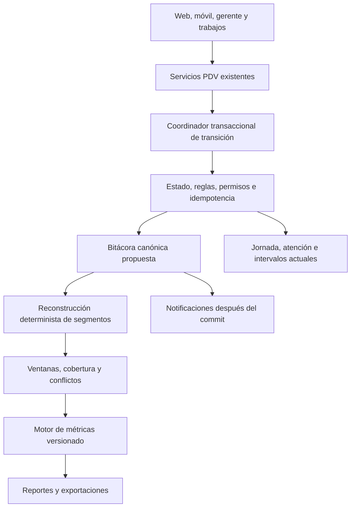

# GELIA — A3.1: contrato de medición operativa y diseño de refactorización PDV

Fecha: 14 de octubre de 2026. Estado: **propuesta para aprobación; sin implementación**.

## 1. Resumen ejecutivo

Se propone conservar los servicios y modelos operativos actuales y añadir una
fuente histórica de transiciones persistidas, con escritura atómica junto con cada
operación. Los intervalos y estados actuales serán proyecciones operativas, no la
única evidencia histórica. Los reportes reconstruirán segmentos verificables desde
las transiciones y distinguirán información completa, parcial, contradictoria y ausente.

Recomendaciones sujetas a aprobación:

1. Separar ciclo de jornada, actividad exclusiva y condiciones de elegibilidad.
2. Registrar asignación, inicio efectivo, fin, pausa, enfriamiento, cierre,
   reactivación y cambios de condiciones sin sobrescribir la historia.
3. Usar tiempo operativo bruto acreditado como base principal de ocupación;
   estudiar jornada neta de pausas como alternativa separada, no sustitución silenciosa.
4. Medir disponibilidad efectiva mediante estados y condiciones acreditadas;
   nunca por ausencia de atenciones o por la etiqueta histórica `disponible` aislada.
5. Versionar la semántica de O-03 a O-07 y las respuestas. Preservar O-02 y los
   promedios completos existentes; no reutilizarlos como denominadores recortados.
6. Certificar hacia adelante solo desde una activación explícita con cobertura
   suficiente. No rellenar ni reconstruir artificialmente el pasado.

**Comprobado** significa respaldado por los archivos y pruebas de A3.
**Propuesto** significa diseño pendiente de autorización, incluidas las fórmulas.
No se modificaron producción, pruebas, migraciones ni datos en A3.1.

Referencia principal: [informe A3](CHECKPOINT_A3_OCUPACION_DISPONIBILIDAD_PDV.md).
Referencias de continuidad: [A1](CHECKPOINT_A1_VENCIMIENTOS_PDV.md) y
[A2](CHECKPOINT_A2_INTEGRIDAD_HISTORICA_PDV.md).

## 2. Estado actual de los registros operativos

| Fuente real | Información disponible y limitación comprobada |
| --- | --- |
| [JornadaPdv](app/Models/PuntoVenta/JornadaPdv.php) | Usuario, sucursal, apertura, cierre, estado, versión y `disponible_desde`. Fila mutable; no representa todos los segmentos de una reactivación |
| [IntervaloOperativoPdv](app/Models/PuntoVenta/IntervaloOperativoPdv.php) | Tipo, extremos, jornada, usuario, sucursal, atención opcional, motivo/actores de pausa. Tres tipos actuales; un abierto por usuario/sucursal, sin garantía general de no solapamiento entre cerrados |
| [TurnoPdv](app/Models/PuntoVenta/TurnoPdv.php) | Alta, sucursal, estado, cierre, baja y atención actual. El estado actual no es una fotografía histórica |
| [TurnoPdvAtencion](app/Models/PuntoVenta/TurnoPdvAtencion.php) | Usuario, turno, secuencia, asignación `inicio_at`, inicio efectivo `atencion_inicio_at`, fin, motivo y transferencia. No tiene `jornada_id` directo |
| [TurnoPdvEvento](app/Models/PuntoVenta/TurnoPdvEvento.php) | Tipo, extremos de estado del turno, atención, actor, fecha, snapshot e idempotencia. No cubre por sí solo todas las transiciones del empleado |
| [MotivoPausaPdv](app/Models/PuntoVenta/MotivoPausaPdv.php) | Identidad y descripción de motivo; algunas pausas admiten motivo ausente; el nombre del catálogo puede cambiar |
| [OperacionPdvEvento](app/Models/PuntoVenta/OperacionPdvEvento.php) | Eventos de sucursal, ligados obligatoriamente a `sucursal_dia_id`; sin campos tipados de empleado/actividad |
| [Auditoría de gestión](app/Models/PuntoVenta/OperacionGestionAuditoriaPdv.php) | Actor, empleado, sucursal, acción y estados/contexto. Cobertura de gestión, no de todo el ciclo; `actor_id` obligatorio |

El [registrador de auditoría](app/Services/PuntoVenta/Operacion/RegistrarAuditoriaGestionOperativaPdvService.php)
asigna `registrado_at` al parámetro `$ahora`; no acredita dos relojes independientes
de ocurrencia y registro. Los eventos de dominio y trabajos de cola no sustituyen
un evento histórico persistido y atómico.

El [selector de disponibilidad](app/Services/PuntoVenta/Operacion/ConsultaPersonaDisponiblePdvService.php)
verifica jornada, fecha operativa, enfriamiento, ausencia de pausa/atención abierta,
elegibilidad y aceptación de altas. La [consulta de elegibles](app/Services/PuntoVenta/Operacion/ConsultaVendedoresElegiblesPdvService.php)
incluye permisos y asignación activa de sucursal. No basta con observar intervalos.

## 3. Problemas de instrumentación confirmados

- La [apertura](app/Services/PuntoVenta/Operacion/AbrirJornadaPdvService.php) crea
  disponibilidad; asignación/inicio de atención no generan una transición equivalente
  a `en_atencion` en los intervalos. La atención existe en su propia tabla.
- [Cerrar atención](app/Services/PuntoVenta/Turnos/CerrarAtencionTurnoPdvService.php)
  actualiza `disponible_desde`; no conserva una secuencia completa e independiente
  de todos los enfriamientos en la fila de jornada.
- [Cerrar jornada](app/Services/PuntoVenta/Operacion/CerrarJornadaPdvService.php)
  conserva una atención pendiente, pero el cierre efectivo del segmento de atención
  y el de la jornada pueden diferir.
- Reactivar y [cancelar cierre pendiente](app/Services/PuntoVenta/Operacion/CancelarCierrePendienteJornadaPdvService.php)
  pueden reutilizar intervalos y sobrescribir extremos previos.
- A3 reprodujo 500 % por bases incompatibles, 175 % con solapamientos sintéticos,
  atención registrada con O-05=0 y disponibilidad de 100 % durante atenciones.
- Los resultados de A3 fueron 20 casos satisfactorios y 10 incompletos, 98 aserciones.
  Son resultados previos, **no una ejecución nueva ni certificación en A3.1**.
- Hallazgo adicional de inspección estática A3.1: el cierre permite actor gerencial
  distinto de quien atendía, pero llama `aplicarCooldown($actor->id, ...)`. Eso
  identifica al autor del cierre, no necesariamente al empleado afectado. No se
  ejecutó una prueba nueva ni se corrigió esa ruta; debe definirse y probarse el
  destinatario del enfriamiento antes de certificar disponibilidad tras cierre gerencial.

Las fuentes actuales permiten mediciones parciales; no prueban ausencia de trabajo
cuando no hay atención, ni justifican calificar pausas como improductividad.

## 4. Modelo de estados propuesto

Se recomienda separar tres dimensiones, en vez de ampliar una lista plana con
combinaciones ambiguas:

| Dimensión | Valores propuestos | Exclusividad y significado |
| --- | --- | --- |
| Ciclo de jornada | Sin jornada, abierta, cierre solicitado, cerrada | Uno por sesión; cierre solicitado puede coexistir con actividad que debe terminar |
| Actividad | Disponible, espera de inicio, atención efectiva registrada, pausa, enfriamiento, bloqueado por operación | Una actividad acreditada por persona en cada instante dentro de una sesión; sin simultaneidad de clientes autorizada actualmente |
| Calidad/contexto | Evidencia suficiente/insuficiente/conflictiva; ausencia administrativa; origen manual/automático; restricciones de sucursal/usuario | Son atributos o condiciones, no tiempo adicional ni estados que se sumen |

Fuera de una sesión no se acredita disponibilidad. `Sin evidencia suficiente` es
resultado de la medición, no una condición que deba bloquear por sí sola el trabajo
actual del empleado. `No llegó` se conserva como marca administrativa; no se convierte
en horas de ausencia inferidas.

Mapeo de compatibilidad:

| Estado actual | Interpretación propuesta |
| --- | --- |
| `NoActivado` / `JornadaCerrada` | Ciclo sin sesión/terminado; distinguir si hubo una sesión anterior |
| `Disponible` | Disponible solo cuando todas las condiciones de asignación estén acreditadas |
| `Atendiendo` | Actualmente también puede abarcar asignación sin inicio. V2 separará espera e inicio efectivo |
| `EnRetencion` | Pausa registrada; preservar etiqueta actual donde sea contrato de clientes |
| `EnEspera` | Actualmente enfriamiento; no confundir con espera de inicio de una atención asignada |
| `CierrePendiente` | Condición de ciclo superpuesta a espera/atención, con nuevas asignaciones bloqueadas |

Reglas candidatas: una asignación reserva a la persona; una pausa impide asignación
e inicio efectivo; atención y pausa son excluyentes; enfriamiento impide nueva
asignación hasta su vencimiento. Si sucursal o elegibilidad bloquean asignación,
el estado no se publica como disponible aunque el usuario esté libre de atención.

El cierre de aceptación de altas no debe por sí solo cancelar una atención ya
asignada. El permiso para reatender o transferir con sucursal cerrada debe seguir
la regla vigente hasta que se autorice expresamente otra; no se deduce de la métrica.

## 5. Matriz de transiciones propuesta

En todas las filas: autorización y sucursal válidas, versión esperada, transacción,
idempotencia y validaciones temporales comunes. `E` = evento persistido con causa y
referencias; `P` = proyección actual compatible. Los nombres de estados V2 son propuestas.

| Origen | Evento | Destino | Validaciones | Persistencia | Rechazo/error y situación actual |
| --- | --- | --- | --- | --- | --- |
| Sin sesión/cerrada | Abrir/reactivar | Abierta + disponible o bloqueado | Sin otra sesión/atención incompatible; verificar condiciones | E de nueva sesión, P de jornada, nuevo intervalo si disponible | No sobrescribir intervalo cerrado. Actual apertura existe; reactivación necesita historia |
| Disponible | Asignar | Espera de inicio | Turno elegible, destino aún disponible al adquirir bloqueos | E reserva, atención con asignación, cierre de disponibilidad | Si carrera con pausa/otra asignación, una gana y otra revalida/rechaza; asignación actual existe |
| Espera de inicio | Inicio manual | Atención | Atención reservada al actor, no pausa, sesión abierta o cierre pendiente autorizado | E de inicio y origen, marca efectiva, intervalo de atención | Doble inicio misma operación devuelve resultado original; hoy falta transición temporal del empleado |
| Espera de inicio | Inicio automático | Atención registrada de origen automático | Configuración aplicable persistida, atención vigente | E de origen/configuración; mismo instante que asignación si esa regla aplica | No afirmar confirmación física del cliente; no duplicar episodio |
| Atención | Finalizar | Enfriamiento, disponible o cierre terminado | Motivo válido, dueño/permiso, sin fin previo | E de fin y límite de enfriamiento; cerrar intervalo una vez | El siguiente estado se calcula, no se presupone disponible |
| Espera de inicio | No se presentó/cancelar reserva | Enfriamiento/disponible/cierre terminado según política | Motivo, atención reservada, ausencia de inicio efectivo coherente | E de resultado, fin de reserva, contexto | No registrar atención ficticia. Cancelación de reserva nueva requiere decisión; baja actual es solo en cola |
| En cola, sin empleado reservado | Baja/cancelación | Turno de baja; empleado sin cambio | Estado en cola y permiso | Evento de turno actual, referencia de causa | No crear tiempo operativo ni atención de un empleado inexistente |
| Disponible | Iniciar pausa | Pausa | Sin atención/reserva, sesión abierta, motivo válido o explícitamente desconocido | E, cerrar disponibilidad, abrir pausa con motivo/actor | Carrera con asignación revalida; pausa ordinaria ya rechaza atención abierta |
| Pausa | Finalizar pausa | Disponible/enfriamiento/bloqueado | Pausa vigente, sesión compatible; recalcular condiciones | E de fin, motivo de final y actor; nuevo intervalo permitido | Reintento no crea otra pausa; no dar disponibilidad si hay otra restricción |
| Pausa | Intentar iniciar atención | Sin transición | Rechazar conflicto | Registro de rechazo operacional, sin evento de cambio ficticio | No terminar pausa silenciosamente; fortalecer comprobación bajo bloqueo común |
| Atención/espera origen + destino disponible | Transferir | Origen se libera según regla; destino espera/inicia automáticamente | Personas distintas, destino elegible, ambas reservadas atómicamente | E correlacionados, fin de segmento origen, nueva atención destino | Operación completa o rollback; conservar origen de inicio. Revisar política de enfriamiento del origen |
| Disponible | Reatender | Espera/inicio automático | Ventana, permisos, destino libre y reglas vigentes | E nueva secuencia del mismo turno | Un episodio nuevo, sin duplicar turno único |
| Enfriamiento | Vence límite | Disponible/bloqueado | Verificar límite registrado y condiciones al vencer | E de condición habilitante o derivación verificable del límite; despertar selector | Retraso del trabajo no puede ampliar ficticiamente el enfriamiento ni afirmar elegibilidad desconocida |
| Abierta sin atención | Solicitar cierre | Cerrada | No actividad pendiente; finalizar pausa si el cierre la termina conforme regla actual | E solicitud/terminación, fin de sesión y de intervalo | Fin de pausa por cierre se distingue de fin solicitado por empleado |
| Abierta + atención/espera | Solicitar cierre | Cierre solicitado, actividad conservada | No nuevas asignaciones; decidir continuidad de reserva | E solicitud; conservar segmento hasta fin acreditado | No truncar atención ni acreditar disponibilidad; actual `CerradaConAtencion` se conserva como proyección |
| Cierre solicitado | Termina última atención | Cerrada | Sin otras reservas/atenciones abiertas | E fin de sesión, extremos finales | Finalizar una vez; distinguir hora solicitada de cierre y hora de terminación |
| Cierre solicitado | Cancelar cierre | Abierta + actividad/condición vigente | Permiso, versión y actividad coherente | E cancelación; no reescribir segmento cerrado | La sesión nunca terminada continúa; no inventar reapertura temporal |
| Cualquier estado acreditado | Cambian condiciones de sucursal/elegibilidad | Mantener actividad o bloquear/liberar asignación | Política vigente y ámbito; no interrumpir atención sin autorización | E de condición con vigencia, versión y causa | La condición global debe afectar disponibilidad, sin generar pausas ficticias |
| Historia errónea | Corrección administrativa | Nueva interpretación versionada | Permiso, evidencia, referencia y motivo | E de corrección; proyección reconstruible | No editar/borrar evento original ni certificar una hora inventada |

Antes de ejecutar cada transición se toma el estado bajo bloqueos. En error de
versión se devuelve conflicto y estado actual autorizado; no se inserta media
transición. Un reintento con la misma clave y contenido reproduce la respuesta;
misma clave con otro turno, actor, destino o contenido debe rechazarse.

## 6. Contrato de eventos y trazabilidad

### Evidencia propuesta

Cada transición debe conservar al menos:

| Campo lógico | Contrato |
| --- | --- |
| Identidad | ID de evento, versión de esquema/contrato, clave de idempotencia, huella de comando |
| Ámbito | Usuario afectado, sucursal, jornada/sesión, turno, atención, intervalo y motivo cuando correspondan |
| Transición | Ciclo y actividad anterior/posterior, condiciones relevantes y causa |
| Relojes | `efectivo_at` UTC y `registrado_at` generado independientemente por el servidor/base; precisión definida |
| Orden | Agregado y secuencia única monotónica por agregado, versión esperada/resultante |
| Origen | Web, móvil, asignador, trabajo programado, gerente o sistema; actor humano nullable para sistema, sin usuario ficticio |
| Contexto | Zona IANA, fecha operativa, política/configuración vigente y vencimiento de enfriamiento; IDs de eventos causales/correlación |
| Corrección | Evento corregido, evidencia y motivo; original conservado |

El reloj del dispositivo se conserva solo como dato de origen no confiable; no se
acepta retrospectividad offline como hecho sin validación/autorización. Eventos
en memoria/broadcast se emiten después del commit; no son la fuente de verdad.

### Reutilización evaluada y persistencia recomendada

| Opción | Evaluación |
| --- | --- |
| Solo intervalos actuales | No conserva todas las actividades, causas ni dos tiempos; su reactivación sobrescribe extremos. No recomendada como verdad histórica |
| Solo eventos de turno/pausa existentes | Reutilizables como referencias y evidencia parcial; faltan inicio efectivo persistido uniforme, sesiones, enfriamientos y condiciones históricas completas |
| Extender `pdv_operacion_gestion_auditoria` | Reutiliza tabla existente, pero mezcla auditoría de gestión con todo el ciclo; actor obligatorio impide origen sistema sin migración y `registrado_at` tiene otra semántica actual. Ampliación posible, con cobertura/compatibilidad por demostrar |
| Extender `pdv_operacion_eventos` | El día de sucursal obligatorio y su propósito global no encajan con todo el flujo individual. Crear días solo para poder auditar no debe alterar aceptación de altas |
| Una bitácora canónica adicional | Recomendada: contrato uniforme para personas y condiciones de sucursal, sin redefinir filas anteriores. Una nueva tabla propuesta, no un reemplazo de todos los modelos |

Nombre provisional: **`pdv_medicion_eventos`**. Migración propuesta exclusivamente
aditiva, pendiente de aprobación: identidad, agregado/tipo/secuencia, referencias,
tipo de evento, dos fechas UTC, versión y payload factual versionado. Índices únicos
para agregado/secuencia e idempotencia; índices de tiempo/usuario/sucursal según
consultas medidas. No se propone inicialmente tabla adicional de sesiones ni snapshots.

Los segmentos de sesión y actividad se derivan de eventos. `JornadaPdv` conserva su
papel actual; `IntervaloOperativoPdv` puede materializar los tres tipos conocidos,
cerrando una vez y creando otra fila al reactivar. Espera, bloqueo y enfriamiento se
representan en eventos; no añadir tipos al enum existente sin actualizar consumidores:
el `match` del cálculo actual solo admite tres tipos y fallaría con otros valores.

La bitácora y el comando se escriben en la misma transacción. Sin confirmación del
evento no se declara instrumentación exitosa. Durante una interrupción se puede
volver explícitamente al modo operativo anterior, suspendiendo certificación desde
el hueco; no fingir una secuencia completa. Append-only requiere guardas de escritura,
permisos y pruebas; declararlo en el diseño no hace inmutables las tablas actuales.

### Concurrencia

Propuesta de coordinador común, reutilizando transacciones y versiones existentes:

1. Lectura inicial de candidatos sin asumir que siguen disponibles.
2. Bloqueo en orden global acordado: sucursales ordenadas, usuarios ordenados, turno,
   jornadas, atenciones e intervalos. Transferir bloquea ambas personas en el mismo orden.
3. Revalidar condiciones y versiones; elegir secuencia del evento bajo el bloqueo
   del agregado. Reservar por usuario, incluso entre sucursales, conforme a la regla
   vigente de no tener otra atención abierta.
4. Persistir comando, eventos y proyecciones en una transacción corta, sin red.
5. Commit, difusión y trabajo de seguimiento. Usar entrega durable/reintento para
   proyecciones asíncronas; no depender de un listener que podría perderse.

El orden exacto requiere revisar todos los escritores antes de habilitarlo; los
servicios actuales no deben mezclarse parcialmente con otra disciplina de bloqueos.
Deadlocks admiten reintento acotado del comando idempotente; conflictos funcionales
no se resuelven agregando estados falsos. La serialización debe probarse en MySQL.

## 7. Definiciones matemáticas propuestas

### Reglas compartidas

Para cada persona y sucursal se construye una línea temporal con evidencia, sin
emplear su estado actual como sustituto histórico. `W` es la ventana absoluta
`[desde, min(hasta, corte))`; para conteos, eventos en el instante exacto del corte
son elegibles si además son anteriores a `hasta`. Un cambio en ese instante aporta
cero duración posterior al corte. Segundos internos con precisión definida; redondeo
solo al presentar. No redondear cada intervalo antes de sumar.

Fecha operativa y franjas se convierten a ventanas por zona IANA de sucursal y se
intersecan con `W`, tanto en numeradores como denominadores. Un cruce de medianoche
se divide analíticamente; no crea actividad. Definir la zona/regla vigente como
parte de la evidencia para que un cambio futuro no redistribuya el pasado.

Filtros de usuario/sucursal se aplican a fuentes compatibles. Servicio requiere
asignar también una base temporal a ese servicio; si no existe esa evidencia, se
permiten volúmenes/duraciones de episodios por servicio, **no** ocupación con un
denominador global no asignable. Motivo de pausa no debe recortar accidentalmente
la base de ocupación global. Alcance/autoridad de acceso se valida al consultar.

No se considera certificada una razón seleccionando solo personas con datos buenos
y ocultando las restantes. Si falta cobertura relevante en la población solicitada,
el valor principal es nulo; se pueden entregar tiempos acreditados parciales con
su limitación y exclusiones, sin extrapolar un porcentaje al total.

| Situación | Tratamiento compartido |
| --- | --- |
| Inicio sin fin | Acumular hasta corte solo si la transición inicial es explícita, vigente y la secuencia está cubierta; marcar en curso |
| Fin sin inicio/hueco de historia | Información insuficiente, no rellenar ni usar duración cero |
| Mismo evento entregado dos veces | Deduplicar por identidad/idempotencia; no cambia el resultado |
| Dos episodios efectivos incompatibles simultáneos | Rechazar en operación futura; historial recibido se marca inconsistente. Unión puede describir tiempo conocido, pero no certifica el conflicto |
| Pausa y atención superpuestas | Conflicto; no elegir prioridad ni sumar como tiempo exclusivo sin corrección documentada |
| Denominador cero | Valor nulo con causa `sin_base_temporal`, no 0 % ni 100 % |
| Numerador cero con cobertura completa y base positiva | Cero medido válido; no significa ausencia de otro trabajo |
| Ausencia de cobertura | `insuficiente`, nunca cero medido |
| Fuentes estimadas | Separadas y etiquetadas; no incorporadas al valor certificado |

### Contrato por indicador

Sea `J` la unión de segmentos de sesión acreditados, `A` la unión de atención
efectiva registrada, `P` la de pausas y `D` la disponibilidad acreditada. Todas las
uniones se realizan primero por persona, se intersecan con `W` y con la sesión
compatible. Agregar entre personas produce **horas-persona**, no horas de reloj.
El signo `|X|` representa duración de un conjunto temporal.

| Indicador propuesto | Definición, fórmula, fuente y población | Abiertos/solapamientos/faltantes | Certificación e historia |
| --- | --- | --- | --- |
| Tiempo operativo bruto | `|J ∩ W|`, segundos. Sesiones abiertas/cerradas/reactivadas reconstruidas por eventos, misma persona/sucursal | Sesión abierta hasta corte; cerrar una sesión y reactivar abre segmento nuevo, excluyendo el hueco. No unir huecos como jornada continua | Requiere todos los extremos/continuidad; histórico legado condicionado. Cierre solicitado con atención mantiene sesión hasta último fin acreditado, propuesta que debe aprobarse |
| Atención acumulada | `|A ∩ J ∩ W|`, segundos. Inicio efectivo y fin por episodio, con referencias a sesión/turno | Abiertos hasta corte. Transferencia termina episodio origen y crea destino; reatención otro episodio. Simultaneidad no autorizada es conflicto | Manual/automático identificados; certifica actividad registrada, no presencia física. Un inicio automático con cierre contradictorio de no presentación requiere calidad explícita, no borrar el inicio |
| Duración completa de episodio | `fin - inicio_efectivo`, segundos por episodio cerrado; no se trunca a W | Atribución por finalización como T-07, fin al corte. Abiertos excluidos del promedio, informados aparte | Media `Σd/n`; mediana sobre la misma muestra; mínimo/máximo y percentiles misma cohorte. Mantener política actual de mínimo 30 para percentiles salvo nueva aprobación |
| Pausa acumulada | `|P ∩ J ∩ W|`, segundos; eventos/intervalos de pausa conservados | Motivo faltante conserva categoría “sin motivo”. Abierta hasta corte con advertencia; conflictos no se ocultan | No juicio de desempeño. No hay certificación exclusiva si existen superposiciones sin resolver |
| Frecuencia de pausas | Conteo de inicios distintos de pausa en W, unidad pausas; mismas personas/sucursales | Pausas iniciadas antes de W se muestran como arrastre temporal, no nuevo inicio. Reintentos no aumentan frecuencia | Depende de eventos de inicio completos; por motivo mantener ID y etiqueta registrada |
| Disponible efectivo acumulado | `|D ∩ J ∩ W|`, segundos. Estado listo y todas las condiciones de asignación verdaderas: sin reserva, atención, pausa, enfriamiento ni cierre pendiente; elegibilidad y sucursal compatibles | No deducir D como hueco de A. Deben conocerse vigencias de condiciones. Falta de historial de permisos/asignaciones/horarios impide certificación | Se necesita observar los cambios que usa el selector real, no solo comandos PDV. O-04 legado queda como dato literal registrado |
| Ocupación bruta | `100 × |A ∩ J ∩ W| / |J ∩ W|`, porcentaje, base positiva y misma población | Propuesta principal. No limitar a 100 para ocultar errores; si A excede J o hay conflictos, invalidar y diagnosticar | Requiere cobertura de J/A completa y reglas de origen aceptadas; ratio puede ser 0 con atención cero acreditada |
| Disponibilidad bruta | `100 × |D ∩ J ∩ W| / |J ∩ W|`, porcentaje | Misma base que ocupación; no es su complemento. Espera, pausa, enfriamiento y bloqueo pueden ocupar el resto | Cobertura de condiciones y estados completa; no reutilizar porcentaje histórico O-07 como si ya midiera esto |
| Turnos únicos atendidos | Distintos `turno_id` con episodio efectivo positivo que inicia en W, unidad turnos | Contar una vez por población de agregación. Por persona puede aparecer el mismo turno en varias personas tras transferencia; total sucursal recalcula distintos, no suma personas | Contrato candidato: volumen de turnos con inicio efectivo, no ventas ni atenciones concluidas. Auto-origen separado; definición de resultado debe aprobarse |
| Atenciones realizadas | Número de episodios cerrados con inicio efectivo y duración válida cuyo fin cae en W, unidad episodios | Transferencia y reatención son episodios diferentes; distinguir motivo y no presentación. Abiertos no se presentan como realizados/cerrados | Fuentes de atención con inicio/fin verificables; no equivale a turno único ni calidad |
| Turnos por hora operativa | Turnos únicos con inicio efectivo en W / (`|J ∩ W| / 3600`), unidad turnos/hora-persona | Misma población, sin sumar distintos duplicados. Base cero nula; comparar cohortes equivalentes | Propuesta de intensidad de volumen, no calificación personal. No implementar sin aprobar numerador y base |
| Distribución del tiempo | Duración de cada actividad acreditada / J, misma ventana | Estados exclusivos; conflictos y tiempo sin evidencia se informan aparte, no se asignan a disponible | No forzar 100 % si falta cobertura. La parte conocida no certifica automáticamente toda la jornada |
| Evolución entre periodos | Diferencias de volumen, tiempos o razones con igual versión, filtros, cobertura y atribución | Media ponderada por episodios; razones por sumas compatibles, no media simple de porcentajes. Base previa cero: cambio porcentual nulo, diferencia absoluta disponible | Requiere comparabilidad explícita; no unir contrato legado/v2 sin advertencia y aprobación |

Los filtros comunes y reglas de calidad anteriores forman parte de **cada fila**.
No se propone medir calidad de atención, satisfacción, venta o dificultad del caso
con estos tiempos. Volumen, velocidad, ocupación y calidad son dimensiones distintas.

### Jornada bruta frente a neta de pausas

| Base candidata | Ventaja | Limitación e impacto |
| --- | --- | --- |
| Bruta `J` — recomendada principal | Estable, auditable y permite observar atención, pausas y otras actividades sin calificarlas | Una pausa reduce la fracción de atención, sin que eso implique peor desempeño. Requiere contexto |
| Neta `J \ P` | Describe ocupación dentro de tiempo no pausado | Excluir pausas puede aumentar la razón y dificultar comparaciones por motivos distintos; una jornada totalmente pausada da base cero. No usar con P incompleta |

No descontar pausa del denominador mientras se deja su eventual superposición en
atención. Cualquier razón neta necesita conflicto resuelto y A contenido en la base
neta. Si se aprueba, debe tener nombre/versión propia y no sustituir silenciosamente
el indicador bruto. Ninguna base se deriva del promedio O-02.

## 8. Indicadores confiables, condicionados y no certificables

| Situación | Dictamen |
| --- | --- |
| Hoy: duraciones de episodios cerrados con marcas válidas | Verificables como actividad registrada, con alcance/origen y contrato A2; no certifican presencia o calidad |
| Hoy: suma de pausas conservadas | Condicionada por continuidad, conflictos, motivos e historia no sobrescrita |
| Hoy: O-04/O-05 literales | Medición de filas etiquetadas; no disponibles/atenciones efectivos certificados |
| Hoy: O-06/O-07 | No certificables globalmente según A3 |
| Futuro: J, A, P tras instrumentación completa | Certificables para ventanas y poblaciones con apertura/contexto conocidos y secuencia sin huecos |
| Futuro: D | Certificable solo si también se capturan elegibilidad, sucursal, enfriamiento y sus cambios relevantes |
| Antes de activación o tras hueco/rollback | Condicionados o insuficientes; no heredan certificación porque el código actual ya esté corregido |
| Productividad/juicio individual | Las métricas propuestas no autorizan una calificación laboral automática |

Certificación exige versión aprobada, evidencia genuina, cobertura del conjunto
solicitado, extremos válidos, población/base compatibles, resolución de conflictos
y permisos de consulta. Debe poder acompañarse de IDs de fuentes y razón de exclusión.

## 9. Tratamiento de información histórica

Se distinguen dos consultas:

1. **Historia operativa revisada:** qué hechos efectivos anteriores al corte pueden
   acreditarse hoy, incluyendo correcciones posteriores identificadas.
2. **Historia registrada entonces:** usar solo eventos efectivos elegibles que ya
   estaban registrados hasta un segundo límite `conocido_hasta`, sin aplicar
   correcciones registradas después. Su resultado conserva versión y fuentes.

`registrado_at` de una inserción no equivale exactamente al instante de visibilidad
del commit. Un ID autoincremental tampoco demuestra orden global de commits.
Para reproducir reportes se recomienda guardar un manifiesto de fuentes confirmadas
visibles en una lectura consistente, corte, límite de registro y versión. Si se exige
reconstruir exactamente “lo visible a las 12:00:00” sin un manifiesto de esa lectura,
se necesita diseñar publicación/orden de commit verificable; no prometerlo solo por
agregar una fecha. Ese nivel adicional requiere aprobación.

No se implementan ni manifiestos ni snapshots en este checkpoint. Un manifiesto
referencia eventos reales; no rellena actividad. Una corrección debe conservar
original, hecho corregido, ambos relojes y autor, sin UPDATE/DELETE del evento fuente.

Activación por usuario/sucursal y versión:

- Abrir una sesión instrumentada verifica estado inicial. Un proceso desplegado a
  mitad de sesión puede registrar una observación real desde ese instante, nunca
  inventar su inicio pasado; no certifica el tramo anterior.
- Segmentos previos sobrescritos permanecen insuficientes. Importaciones, orígenes
  desconocidos y cambios retroactivos no se normalizan para que coincidan las cifras.
- Reactivar crea nuevo segmento; cancelar un cierre solicitado no fabrica un segmento
  cerrado si todavía no terminó. Conservar separación entre solicitud y terminación.
- Abiertos olvidados se señalan para revisión; no cerrar automáticamente con una hora
  estimada. Una corrección con evidencia declara su fecha efectiva y de registro;
  sin evidencia, terminar desde la constatación actual y dejar el hueco no certificado.
- Históricos legados conservan contrato anterior o devuelven insuficiencia para v2.
  Ningún backfill está autorizado ni es requisito de esta propuesta.

## 10. Arquitectura recomendada

Responsabilidades propuestas, **archivos aún no creados**:

| Componente candidato | Responsabilidad y reutilización |
| --- | --- |
| `Operacion/RegistrarTransicionMedicionPdvService` | Evento canónico dentro de la transacción del comando, sin duplicar autorización ni disparar otro ciclo operativo |
| `Operacion/ResolverActividadMediblePdvService` | Estado exclusivo y condiciones; compartir predicado con selector operativo, con pruebas de equivalencia antes de reemplazarlo |
| `Reportes/ReconstruirSegmentosOperacionPdvService` | Eventos → sesiones/actividades, dos límites temporales, versiones y anomalías; función determinista sin mutaciones operativas |
| `Reportes/CalcularTiemposAcreditadosPdvService` | Intersecciones/uniones y calidad por usuario/sucursal; sin inventar estados en huecos |
| `Reportes/CalcularMetricasOperacionV2PdvService` | Fórmulas aprobadas; no cambia los promedios completos de atención/jornada legados |
| Adaptadores actuales | `ObtenerPayloadMetricasReportePdvService`, controlador de métricas, filas PDF/CSV y definiciones usan la misma versión/fuentes |

Consumidores reales que deben inventariarse antes de cambiar contratos:

- [Cálculo actual](app/Services/PuntoVenta/Reportes/TurnosOperacion/CalcularMetricasReporteTurnoOperacionPdvService.php),
  desglose por sucursal y [aplicación de filtros](app/Services/PuntoVenta/Reportes/TurnosOperacion/AplicarFiltrosReporteTurnoOperacionPdvQuery.php).
- [Shell React](resources/js/Pages/PuntoVenta/Reportes/ReportePdvShell.jsx),
  [utilidades](resources/js/Pages/PuntoVenta/Reportes/reportesPdvUtils.js), tarjetas y detalle;
  selector/estado operativo, recepción, ventas y serializadores de turno.
- [Filas de exportación](app/Services/PuntoVenta/Reportes/FilasExportacionReportePdvService.php),
  generadores CSV/PDF, solicitud, trabajos y tracker; una exportación asíncrona no
  debe recomputar con otra versión o un corte/fuente móvil sin explicitarlo.
- [Controlador móvil](app/Http/Controllers/Api/V1/Mobile/PuntoVenta/TurnoPdvMobileController.php),
  broadcasts y listeners; no romper `Atendiendo`, `EnEspera` ni `en_curso` existentes.

Respuesta V2 propuesta: valor nullable, unidad, numerador/denominador si corresponde,
versión de contrato, ventana/cortes, `naturaleza` (explícita/derivada/estimada),
`calidad` (certificada/condicionada/insuficiente/inconsistente), motivos, población,
cobertura acreditada y abiertos. Una estimación no usa el campo certificado.
Mantener `en_curso` compatible en v1; en v2 separar cantidad de abiertos de booleano,
pues la exportación actual interpreta solo ciertos valores como verdadero.

No mutar los significados de O-04/O-05/O-06/O-07 bajo la misma versión. Versionar
los indicadores/respuesta y mostrar que un histórico legado no es comparable con v2.
Los nombres de clases, tabla y estados se confirman en diseño de implementación;
su aparición aquí no constituye implementación ni aprobación de migración.

## 11. Plan de refactorización incremental

| Fase | Trabajo autorizado a proponer | Criterio de salida |
| --- | --- | --- |
| 1. Contrato y compatibilidad | Aprobar decisiones §14, vocabulario, fórmulas, origen automático, cohortes, respuesta, consumidores y tratamiento legado | Documento aprobado; invariantes ejecutables planificadas, sin cambio de semántica oculto |
| 2. Instrumentación | Migración aditiva aprobada, escritura atómica de transiciones en todos los escritores, no sobrescribir intervalos, gates y origen; proyección paralela | Sesión instrumentada completa y trazable; sin cambio accidental en asignación, prioridad, enfriamiento o permisos |
| 3. Motor de métricas | Replay determinista, ventanas coherentes, conflictos/cobertura y fórmulas v2; preservar promedios completos | Oráculos de servicios reales y propiedades temporales; nulo explícito ante insuficiencia |
| 4. Integración | Opt-in/versionado de reportes, filtros, desglose, PDF/CSV, respuestas y etiquetas; sin rediseño visual aún | Misma fuente/versión entre pantalla y exportación; compatibilidad móvil/broadcast demostrada |
| 5. Verificación integral | Concurrencia MySQL aislada, pruebas de recuperación, rendimiento, canario y validación de integridad | Puertas de aceptación objetivas y reversión ensayada; certificación solo de ventanas cubiertas |

Despliegue propuesto: expansión de esquema compatible; modo de instrumentación
paralela con fuente operativa vigente; validación por cohortes; lectura v2 opt-in;
canario de sucursal autorizado y posterior ampliación. No hacer dos asignaciones
“en paralelo”: se duplica evidencia/proyección, no la operación de negocio.

Si cambia el estado publicado o el bloqueo de una transición, deja de ser solo
instrumentación y requiere aprobación funcional y pruebas de compatibilidad.

Reversión: desactivar lector v2 y volver al contrato anterior identificado; conservar
bitácora/tablas nuevas, no ejecutar `down` que borre evidencia. Volver a escritores
antiguos implica un hueco de cobertura; al reactivar medición no certificar ese tramo.
Una corrección o proyección dañada se reconstruye desde evidencia conservada; no
revertir hechos reales ni editar registros antiguos para igualar estadísticas.

Observabilidad propuesta: comandos sin evento/huérfanos, huecos de secuencia,
idempotencia conflictiva, intervalos solapados, retrocesos temporales, retraso de
proyección, integridad usuario/sucursal, A fuera de J, cobertura de condiciones,
estados imposibles, latencia de transacción, deadlocks y errores por fuente/versión.
Los límites de aceptación de carga/latencia se fijan con una base de medición en
entorno de pruebas; no se inventan objetivos de rendimiento cumplidos.

## 12. Estrategia de pruebas y validación

No se ejecutaron ni modificaron pruebas en A3.1: es un cambio documental. Los
resultados A3 se citan como evidencia anterior. Las siguientes son pruebas futuras,
para A3.2 y fases posteriores una vez aprobado el contrato:

| Comportamiento | Prueba real y oráculo esperado propuesto |
| --- | --- |
| 1. Abrir → disponible | Ejecutar servicio con sucursal/elegibilidad válidas; una sesión/evento, selector y medición coinciden. Con gate cerrado no inventar disponibilidad |
| 2. Asignar → reservar | Ejecutar asignador; baja disponibilidad en la misma transacción, crea espera e identifica atención |
| 3. Iniciar → atender | Servicio manual/automático con origen; fin de espera y disponible ausente durante atención |
| 4. Finalizar | Mismo fin en atención/evento/segmento; elegir enfriamiento, bloqueado o cierre, no siempre disponible. Probar cierre gerencial distinguiendo autor y empleado que recibe enfriamiento |
| 5–6. Iniciar/finalizar pausa | Servicios reales, motivo/actor, límites y bloqueo. Final recalcula condiciones; sin razón se conserva “sin motivo” |
| 7–8. Pausa con atención / inicio con pausa | Rechazo sin media transición; mismas comprobaciones con carrera concurrente |
| 9. Transferencia | Dos usuarios, operación atómica, segmento origen cerrado, destino reservado, mismo turno sin duplicarlo en total |
| 10. Reatención | Nueva secuencia con ventana autorizada; cuenta episodio, no nuevo turno único en agregado |
| 11. Cierre con pendiente | Registrar solicitud y fin separado; sin nuevas asignaciones, atención continúa acreditada y termina sesión según contrato |
| 12. Reactivación | Nuevo segmento/intervalo, extremos anteriores intactos; replay del pasado idéntico |
| 13. Concurrencia | Dos conexiones/procesos MySQL con barreras: asignar/pausar, iniciar/cerrar, dos asignaciones, transferencias cruzadas. Un ganador y reintento/conflicto válido, sin doble reserva |
| 14. Solapamientos | Generarlos como anomalía de entrada de pruebas; detectar, no legitimarlos con suma o tope 100; corrección append-only |
| 15. Historia | Nuevo evento posterior no cambia corte anterior; corrección retrospectiva sí cambia historia revisada, no consulta con límite de registro previo |
| 16. Filtros | Usuario/sucursal, ventanas cruzando medianoche y zona, franja, evento exactamente en corte/hasta, base compatible. Servicio sin base asignable rechaza la razón |
| 17. Información ausente | Hueco/evento sin inicio, legado, origen desconocido: nulo y razón. Cero solo con cobertura acreditada |
| 18. Proporciones | J abierta/cerrada y segmentos reactivados; base independiente de O-02; 0–100 solo si invariantes satisfechas, sin saturar errores |

Propiedades adicionales: duplicar entrega de un evento no cambia resultado; ordenar
por fecha/secuencia definida produce replay estable; particionar W y sumar acumulados
conserva el total; duraciones por persona no se duplican; se rechaza contradicción
entre pausa y atención; los promedios completos conservan su cohorte y duración.

Pruebas existentes a conservar:

- `tests/Unit/PuntoVenta/Reportes/CalcularMetricasReporteTurnoOperacionPdvTest.php`
  e `IntegridadHistoricaReportePdvTest.php`: mantener controles A2 y promedios completos.
- `OcupacionDisponibilidadReportePdvTest.php`: mantener los diez diagnósticos como
  pendientes de v1 hasta su resolución aprobada. Añadir oráculos v2 de servicios;
  no borrar ni convertir en aprobado un diagnóstico solo por ocultar su síntoma.
- `tests/Feature/PuntoVenta/{JornadaDisponibilidadOperacionPdvTest,PausaOperacionPdvTest,PausaGerencialMotivosPdvTest,MatchmakerTurnosPdvTest,CicloAtencionTurnosPdvTest}.php`:
  conservar permisos, idempotencia, prioridad/FIFO, enfriamiento, rechazo de pausa
  con atención, cierre pendiente, transferencia y reatención.
- Pruebas del resolver/auditoría de operación, `PercentilesPdvTest.php`, exportaciones
  y utilidades React: adaptar únicamente diferencias de contrato autorizadas;
  preservar resultados de versión anterior y compatibilidad de clientes.
- A1 y los diagnósticos históricos de resguardos no se modifican por esta refactorización.

SQLite en memoria sirve para casos deterministas, no demuestra bloqueo real. La
prueba MySQL será aislada, sin red hacia servicios productivos y con base efímera.
Simular colas/broadcast donde no sean el objeto, y verificar entrega post-commit y
recuperación en pruebas específicas. No instalar herramientas ni ejecutar suites
globales para este documento.

## 13. Riesgos operativos y compatibilidad

- Añadir persistencia a cada transición aumenta escrituras y puede elevar contención.
  Cambiar el orden de bloqueos por partes puede causar deadlocks; inventariar escritores.
- El selector depende de permisos/asignaciones que pueden cambiar fuera de PDV.
  Sin capturar su vigencia, D no es certificable. Instrumentar esos cambios puede
  cruzar módulos y necesita alcance/autorización propia; no esconderlo como detalle.
- Inicios automáticos, espera, cierre con cliente pendiente y transferencia pueden
  tener efectos diarios al formalizarse. Medir no autoriza cambiar sus reglas.
- Ampliar enums o cambiar estados publicados puede romper mobile, serializadores,
  `match`, broadcasts y consumidores de reportes. Preferir adaptadores versionados.
- La bitácora propuesta conserva IDs/contexto necesario, no copias innecesarias de
  datos personales. Acceso y correcciones deben respetar alcance vigente.
- Las proyecciones actuales pueden seguir siendo mutables; eso solo es aceptable
  si el hecho fuente queda conservado y ningún reporte certificado depende de su
  valor actual como sustituto del pasado.
- Un informe reproducible necesita fuentes y versión. Tener dos timestamps sin
  control de commit/publicación no garantiza “lo conocido entonces” con precisión total.
- Histórico insuficiente no se corrige desplegando código nuevo. No mezclar periodos
  certificados y legados en una serie o ranking sin contexto explícito.

## 14. Tabla de decisiones pendientes de aprobación

Todas las filas son propuestas; **ninguna decisión se considera aprobada por este
documento**. P0 precede a instrumentación; P1 precede a certificación/integración.

| ID/problema | Alternativas | Recomendación y motivo | Impacto funcional/semántico | Impacto técnico | Riesgos | Migración | Compatibilidad anterior | Prioridad |
| --- | --- | --- | --- | --- | --- | --- | --- | --- |
| D1. Estados mezclados | Lista plana / dimensiones | Ciclo + actividad exclusiva + condiciones: evita doble disponibilidad | Separa espera de inicio de `Atendiendo` y enfriamiento de `EnEspera`; publicar solo mediante v2 | Resolver común y adaptadores | Cambiar reglas de asignación por error | No por sí sola | Mapear enums v1, no renombrar sin versión | P0 |
| D2. Fuente histórica | Intervalos / ampliar auditorías / bitácora canónica | Una tabla canónica, reutilizar servicios/modelos como proyecciones; evidencia uniforme | No cambia por sí sola prioridades/permisos | Evento atómico, secuencias, índices | Escrituras/contención y disciplina de inmutabilidad | Sí, aditiva propuesta | No backfill; fuentes anteriores condicionadas | P0 |
| D3. Sesiones y reactivación | Sobrescribir / nuevos segmentos | Nuevo segmento con intervalo nuevo; cierre solicitado distinto de final | Preserva reapertura sin cambiar historial; sesión termina tras pendiente según contrato propuesto | Replay de sesiones, referencias y comandos coordinados | Atención después de cierre cambia base respecto de hoy | Cubierta por D2; otra tabla no inicialmente | No reconstruir extremos perdidos | P0 |
| D4. Ocupación | Base bruta / neta de pausas | Bruta principal: misma población/ventana y lectura contextual | Cambia semántica O-06; neta solo con nombre propio | Motor J/A recortado separado de O-02 | Comparaciones laborales engañosas | No adicional a D2 | Versionar, no homologar legado | P0 |
| D5. Disponibilidad | Etiqueta disponible / condiciones efectivas | Estado listo + gates acreditados; insuficiente si falta vigencia | Cambia O-04/O-07 efectivos; nunca complemento automático | Capturar gates, enfriamiento y elegibilidad; posible trabajo en módulos de permisos | Cobertura incompleta fuera de PDV | D2; alcance adicional por decidir | Mantener acumulado literal v1 | P0 |
| D6. Origen automático | Igual al manual sin indicar / separado / excluir | Incluir solo como atención registrada identificada, con conflictos explícitos | No afirma presencia física; aceptación para indicador efectivo debe aprobarse | Persistir origen y regla vigente | Cierre no presentación contradice inicio | D2 | Origen no acreditado queda condicionado | P0 |
| D7. Pausas y conflictos | Prioridad silenciosa / sumar / invalidar | Rechazar nuevos conflictos; invalidar razón y revisar evidencia del pasado | No valorar pausa como improductividad ni forzar cierre | Detección/correcciones append-only; motivo desconocido permitido explícitamente | Pausas olvidadas y correcciones sin hora comprobada | D2 | Nunca inventar razón o fin previo | P0 |
| D8. Volumen/productividad | Episodios / turnos distintos / ventas | Turno distinto con inicio efectivo en W; episodios cerrados separados | Nuevo significado aprobado antes de métricas; no calificación de desempeño | Distintos según nivel, no suma de usuarios | Transferencias duplicadas/complexidad no medida | No adicional | Datos legados con alcance y calidad | P1 |
| D9. Filtros | Atribuir por inicio / intersecar ventanas | Acumulados y razones por intersección local; episodios completos por cohorte | Cambia distribución en franjas, conserva promedios A2 | Ventanas por zona y versión de regla | DST/medianoche y bases por servicio inexistentes | D2 para contexto | Contratos separados y comparación condicionada | P0 |
| D10. Dos tiempos | Solo efectivo / registro dual / visibilidad exacta | Dual + manifiesto de fuentes para reproducir informes; nivel commit exacto aparte | Distingue historia revisada y registrada | Límites de lectura consistente y versión; manifiesto futuro sujeto a aprobación | Prometer visibilidad histórica imposible con ID/fecha solos | D2; persistencia de manifiesto por aprobar | No atribuir dos tiempos al legado | P1 |
| D11. Respuesta y legado | Sustituir IDs / versionar | Versión v2 con calidad/nulos y v1 explícito | Cambia significado, no formato silenciosamente | Adaptar PDF/CSV/React/móvil y `en_curso` | Clientes asumen cero/booleano/porcentaje comparable | No adicional obligatoria | V1 conservado, v2 insuficiente en huecos | P0 |
| D12. Despliegue y fallo de medición | Bloquear todo / seguir sin certificar | Escritura atómica; reversión operativa explícita con suspensión de certificación | Disponibilidad del servicio y medición quedan diferenciadas | Flags por cohorte, observabilidad, rollback sin borrar tabla | Huecos al volver a escritores antiguos | D2 | Ninguna promesa retroactiva de continuidad | P0 |
| D13. Transferencia/cancelación/pendiente | Preservar reglas / redefinir retorno | Preservar selección/retorno actual salvo contradicción aprobada; definir explícitamente reserva cancelada y atención pendiente | Puede afectar enfriamiento y capacidad cotidiana; no lo autoriza una fórmula | Integración en escritores y pruebas reales | Introducir cancelación o pausa implícita no existente | No adicional obligatoria | Nuevas transiciones no se imputan al pasado | P0 |
| D14. Autor frente a empleado afectado | Enfriar al actor / a quien atendía | Propuesta: al empleado de la atención, conservando actor separado; validar primero el caso gerencial | Puede corregir quién queda impedido para asignación; cambio operativo requiere aprobación | Revisar `aplicarCooldown` y probar gerente/empleado distintos antes de cambiarlo | Medir disponibilidad del sujeto equivocado | No adicional obligatoria | No reasignar retrospectivamente enfriamientos sin evidencia | P0 |

La autorización solicitada debe indicar las filas aceptadas y las alternativas
elegidas. Aprobar A3.1 no debe interpretarse como permiso genérico para migrar,
instrumentar permisos de otros módulos o añadir snapshots/backfills.

## 15. Propuesta de orden de implementación

1. **A3.2:** tras aprobación explícita, convertir D1–D7/D9/D11–D14 en contrato
   ejecutable, alcance de escritores y diseño de migración revisable. Confirmar
   si esa autorización incluye implementación o solo preparación de esa fase.
2. Instrumentación mínima de una sesión completa: apertura, reserva, inicio, cierre,
   pausa, enfriamiento, pendiente y reactivación; conservar operación y datos anteriores.
3. Capturar condiciones de disponibilidad y probar carreras/reintentos antes de
   certificar D. No publicar O-07 efectivo si solo está completa la atención.
4. Motor temporal y de calidad; habilitar J/A/P y ocupación únicamente con cobertura.
   Mantener promedios completos y tests A2.
5. Integración versionada, exportaciones coherentes, canario y reversión ensayada.
6. Solo después y con D8/D10 aprobadas: productividad, comparaciones certificadas y
   reproducción persistida de informes. El dashboard visual sigue fuera de esta fase.

## 16. Estado final del checkpoint

**A3.1 concluido como diseño para aprobación. No se inició la refactorización.**

Archivo nuevo único: `CHECKPOINT_A3_1_CONTRATO_MEDICION_PDV.md`. Sin cambios de
producción, esquemas, pruebas o fórmulas; sin instalaciones, datos productivos,
commits ni push. A1/A2 y los hallazgos/pruebas A3 permanecen intactos.

Validación de esta etapa: inspección focalizada y consistencia de referencias del
documento, más comparación de los cambios previos. No se ejecutaron nuevas pruebas
automatizadas ni se presentan las estrategias futuras como resultados aprobados.

Se detiene el trabajo y se espera aprobación para A3.2, con las decisiones de §14.
