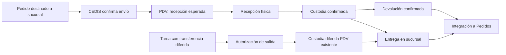

# CHECKPOINT P1.1 — Reconstrucción histórica y documental de Control de Pedidos

Fecha de investigación: 14 de octubre de 2026. Código contrastado: `861cb19d0e7ffbdb3695f9443723145e286fb8d1`. Estado: **investigación y propuesta para revisión; sin implementación**.

## 1. Resumen ejecutivo y aclaraciones del responsable

Control de Pedidos **ya procesaba pedidos con transportes locales/municipales mediante CEDIS antes de existir Preparación Tienda**. El código versionado de julio contiene catálogo local/regional, envío diferido, empaque en CEDIS y confirmación de enviado. En agosto se agregó una capa de tareas Tienda con dos extensiones diferentes: Tienda→CEDIS mediante Traspasos y Tienda→municipio mediante carátula. Los documentos exigían conservar el proceso anterior, no reemplazar el módulo comercial ni convertir cualquier destino municipal en origen PDV.

Se localizó el cambio concreto que explica el reemplazo del almacén: **`9493ec9`, 12 de octubre**, restringe a PDV el default de preparación y agrega el efecto React que sustituye/vacía el almacén seleccionado. El mismo commit retira la revisión sin pesaje para logística local que había incorporado **`56189aa`, 9 de octubre**. Son cambios funcionales dentro de una entrega amplia; no basta atribuirlos a que «la vista cambió». El código y los tests muestran una decisión técnica explícita, pero no se encontró una autorización operativa que justifique extenderla a todos los casos afectados.

**CP6b de P1 debe corregirse conceptualmente:** CEDIS→municipio no es, en bloque, una capacidad nueva. La clasificación principal es **D: confusión de flujos distintos**, con **B: capacidades anteriores parcialmente conservadas** y **A: reducción confirmada de elegibilidad de preparación y de consulta sin pesaje** en casos concretos. No se acreditó un circuito histórico completo CEDIS→traspaso físico a Tienda→municipio; esa parte no debe reconstruirse como si estuviera probada.

El responsable precisó durante esta investigación los siguientes requisitos vigentes. Son evidencia operativa aportada en esta conversación, no inferencias de los commits:

| Id | Aclaración operativa vigente | Consecuencia para la recuperación |
| --- | --- | --- |
| U1 | La separación CEDIS es necesaria para distinguir casos internos de Bellaroma y Aromas | Conservar la función y su distinción; corregir únicamente los acoplamientos que excedieron ese alcance |
| U2 | Para Aromas era necesaria evidencia de la captura al enviar el pedido a Tienda para procesamiento posterior; pesaje no en ese paso | Probar evidencia obligatoria y ausencia de pesaje obligatorio en **ese hito**. No convertirlo en «Aromas nunca necesita peso» ni equiparar evidencia documental con todas las fotos de ejecución |
| U3 | Número de remisión y búsqueda de guías corresponden a una mejora solicitada | Conservar el campo, su identidad y el objetivo de búsqueda; verificar continuidad entre captura y consumidor |
| U4 | El modal actual es conveniente y se ajusta al diseño; varias mejoras visuales deben quedarse | Sin retorno a una UI antigua ni rediseño general. La refactorización debe respetar el diseño y recuperar el contrato funcional |
| U5 | Se agregaron campos/funciones no solicitados y se alteraron procesos durante refactorizaciones | Revisar procedencia por campo/acción; una propuesta escrita por desarrollo no demuestra aprobación del usuario. No declarar todos los cambios recientes erróneos |
| U6 | Pedidos estaba integrado con PDV y resguardos de sucursales; debe conservarse esa continuidad | Incluir envío→recepción→custodia→entrega/devolución y la custodia diferida local en la matriz de regresión. Reutilizar el módulo existente |

Conclusión de alcance: recuperar capacidades verificadas y preservar mejoras solicitadas, con integridad de captura, documentos y resguardos. **No regresar todo a una versión antigua, no crear otra arquitectura de preparación ni otro módulo de resguardos.**

## 2. Método, límites e índice documental local

### 2.1 Descubrimiento y trazabilidad

Se descubrió la raíz real `/home/ti-admin/gelianv` y se recorrieron nombres y contenido con `rg --files --hidden --no-ignore` y búsquedas acotadas. Se incluyeron Markdown, texto, HTML y extensiones de diagramas, y se revisaron familias relacionadas de `Implementaciones/`, `docs/`, `documentacion/` y `Legacy/`, además de documentación raíz y referencias internas. Se excluyeron dependencias, `.git`, compilados, almacenamiento/logs operativos, snapshots, temporales, dumps de BD, archivos de entorno y binarios irrelevantes. No se leyeron credenciales ni se consultaron datos operativos.

Se contrastaron archivos versionados con `git log --all`, `git show` y diffs, sin checkout. No se ejecutaron pruebas, Artisan, migraciones, commits, push ni `git add`. P1 ya era un archivo no rastreado al iniciar; se conserva intacto. P0 y P1 no se reescriben.

**Hallazgo de búsqueda:** las familias de implementación relevantes sí existen localmente y están ignoradas (`.gitignore:29`, `/Implementaciones`; `.gitignore:34`, `/docs`, salvo archivos ya rastreados). No aparecer en `git ls-files` no implica inexistencia. R = rastreado; I = ignorado; s/f = sin fecha interna comprobada. No se usan fechas de modificación del filesystem para datar decisiones. Los documentos se citan por ruta, sección y línea inicial; los nombres en la tabla identifican el documento, no solo un archivo sin interpretación.

### 2.2 Diseño inicial y evolución previa a tareas Tienda

| Id / ruta relativa real | Documento / fecha-versión / Git | Etapa y relevancia | Evidencia concreta, relación y contradicción |
| --- | --- | --- | --- |
| D01 `Implementaciones/Control_Pedidos/fase1_vista_vendedoras.md` | Base de Datos y Vista Vendedora; s/f; I | Registro original; alta | §1, línea 11: almacenes PDV/VTA como origen físico; §2.D, línea 111: selección de salida. Antecede a D04, no identifica almacén con canal comercial |
| D02 `Implementaciones/Control_Pedidos/fase2_auxiliar_pedidos.md` | Panel Auxiliar; s/f; I | Auditoría; alta | §3, líneas 52/59/72: datos consultados, pago y remisión como acciones. Separa revisión administrativa de empaque D03 |
| D03 `Implementaciones/Control_Pedidos/fase3_cedis_control_pedidos.md` | Panel CEDIS; s/f; I | Empaque original; alta | Introducción línea 3 y §3, línea 47: CEDIS recibe aprobados, empaca o reporta. Su estado final evoluciona en D05–D07 |
| D04 `Implementaciones/Control_Pedidos/mejoras_fase2.md` | Segunda ronda; s/f; I | Orígenes y logística; alta | §3.A, línea 41: `requiere_logistica`; §4.C, línea 70: CEDIS también procesa Mostrador. «Tienda» no representa una tarea ni impone PDV |
| D05 `Implementaciones/Control_Pedidos/mejoras_fase_2_2.md` | Mejoras 2.2; s/f; I | Rastreo/Delegado; alta | §2, línea 12: local sin rastreo finaliza al empacar; D07 lo reemplaza por confirmación de envío. No restaurar este cierre obsoleto |
| D06 `Implementaciones/Control_Pedidos/mejoras_fase_2_3.md` | Mejoras 2.3; s/f; I | Bandejas; media | §1, línea 8: conservar pedido empacado visible. Contradice la desaparición propuesta en D05 |
| D07 `Implementaciones/Control_Pedidos/mejoras_rapidas.md` | Sistema PedidosBMA; s/f; I | Ciclo con Delegado; alta | §1, línea 3: CEDIS empaca; local pasa PENDIENTE_DE_ENVIO; CEDIS confirma enviado. Corrige D05; coincide con código de julio |
| D08 `Implementaciones/Control_Pedidos/mejora_flujo_pedidos_envios_diferidos.md` | Envíos diferidos; s/f; I | Municipio anterior a tareas; alta | §2.2, línea 40: transportista local y costo posterior, mismo folio; §4.5, línea 286: CEDIS; §7, línea 348: aceptación. No ordena transferir físicamente a Tienda |
| D09 `Implementaciones/Control_Pedidos/fase4_automatizacion_tipo_envio.md` | Automatización UX; s/f; I | Tipo financiero/logístico; alta | §Reglas, línea 5: deriva MUNICIPIO_DIFERIDO por flag de paquetería; línea 17: origen solo gobierna logística. No equivale a ENVIO_MUNICIPIO de tareas |
| D10 `Implementaciones/Control_Pedidos/fase5_complemento_principal.md` | Complemento principal; s/f; I | Consolidación; media | §Modelo, línea 5; §CEDIS, línea 32. Complemento comercial no es cambio de ubicación; D17 lo delimita expresamente |
| D11 `Implementaciones/Control_Pedidos/fase_fixesymejoras_1.md` | Fixes/catálogos; s/f; I | Catálogos; media | §2, línea 32: paqueterías locales; §4, línea 80: visibilidad de almacenes, sin crear otra tabla. D18 amplía reglas de transportes |
| D12 `Implementaciones/Control_Pedidos/correciones_fase1.md` | Mejoras vendedoras; s/f; I | Captura inicial; media | §2, línea 22; §Envío y Costos, línea 50: selector Envío/Tienda. Evidencia de etiqueta antigua, no de asignación física a un preparador |
| D13 `Implementaciones/Control_Pedidos/mejoras_2_1.md` | Folios duales/auditoría; s/f; I | Documentación; media | §1, línea 3 y §3, línea 10: identidad y visor. Evoluciona a referencias y número de remisión, no eliminar esas mejoras |
| D14 `Implementaciones/PARTE-1-MEJORAS-GESTION-PEDIDOS.md` | Observaciones Parte 1; s/f; I | Revisión/pesaje CEDIS; alta | RF-04, líneas 150–180: Tipo de pedido y Tipo CEDIS independientes; RF-05, línea 187: consulta/evidencia. Fundamenta conservar separación, no peso universal |
| D15 `Implementaciones/gestion_pedidos/mejoras.md` | Consulta continua CEDIS; s/f; I | Consulta antes de cobro; alta | §Flujo, línea 7: Envío pesaje / Tienda piezas, ambos atendidos por CEDIS y luego cierre. Contrasta con gate de Tienda añadido en agosto |
| D16 `Implementaciones/gestion_pedidos/fixes.md` | Correcciones de consulta; s/f; I | Conservación de captura; alta | §2, línea 11: soporte también para Tienda; §4, línea 27: pago tras consulta; §6, línea 39: actualizar sin borrar respuesta/costo. Mantener mejoras |

### 2.3 Extensión de tareas y documentación posterior

| Id / ruta relativa real | Documento / fecha-versión / Git | Etapa y relevancia | Evidencia concreta, relación y contradicción |
| --- | --- | --- | --- |
| D17 `Implementaciones/gestion_pedidos_v2/05_FASE_ENVIO_BODEGA_Y_TRASPASO_A_CEDIS.md` | Fase 5 Bodega; s/f; I | Tienda→CEDIS; alta | §1, línea 7; §4, línea 64; §5, línea 81: mercancía de Tienda, traspaso real, no complemento ficticio por ubicación. No acredita dirección inversa CEDIS→Tienda |
| D18 `Implementaciones/gestion_pedidos_v2/06_FASE_ENVIO_MUNICIPIO_Y_CARATULAS.md` | Fase 6 Municipio; s/f; I | Tienda→municipio; alta | §1, línea 7: sustituir carátula manual OneDrive; §5, línea 65: tarea Tienda; §12.12, línea 227: flag apagado conserva proceso municipal anterior |
| D19 `Implementaciones/gestion_pedidos_v2/04_FASE_TAREAS_DE_PREPARACION_Y_MODULO_TIENDA.md` | Fase 4 Tienda; s/f; I | Nueva área de preparación; alta | §2, línea 11: pedido comercial + tareas; §4, línea 96: lista administrable de almacenes, no hardcodear; §14, línea 345: preservar anterior con flag apagado. Recoge local evoluciona en D23/D24 |
| D20 `Implementaciones/gestion_pedidos_v2/03_FASE_FORMULARIO_PROGRESIVO_DE_VENTAS.md` | Fase 3 Progresivo; s/f; I | Captura; alta | §1, línea 7: preservar autoguardado y CEDIS; §3, línea 19: no monolito renombrado; §9, línea 199: único store, no nullificar ocultos. La implementación quedó parcial |
| D21 `Implementaciones/gestion_pedidos_v2/00_REGLAS_GLOBALES_PARA_AGENTES.md` | Reglas del paquete; s/f; I | Contrato común; alta | §4.4, línea 108: apagar flag devuelve nuevos pedidos al flujo vigente; §5, línea 121: mismo pedido, tareas físicas; §9, línea 225: concurrencia. Especificación no es prueba de entrega |
| D22 `Implementaciones/gestion_pedidos_v2/01_FASE_INTEGRIDAD_FINANCIERA_Y_AUXILIAR.md` | Fase 1 Financiera; s/f; I | Pago y permisos; media | §3, línea 24; §5, línea 88: versiones/cobertura y exhibiciones. Justifica conservar controles, no confundirlos con preparación física |
| D22a `Implementaciones/gestion_pedidos_v2/02_FASE_ENVIOS_MULTIPLES_Y_EVIDENCIA_POR_CAJA.md` | Fase 2 Cajas; s/f; I | Evidencia y costos; alta | §4, línea 41: actualización no destructiva e identidad; §5, línea 71: cálculo. No universalizar cajas a toda separación interna |
| D22b `Implementaciones/gestion_pedidos_v2/07_FASE_ESPERA_CANCELACION_Y_LIBERACION.md` | Fase 7 Cancelación; s/f; I | Liberación física; media | §13, línea 223 y §14, línea 234: idempotencia/compatibilidad. No equivale a devolución de resguardo PDV sin coordinación |
| D22c `Implementaciones/gestion_pedidos_v2/08_ESPECIFICACION_UX_Y_FLUJO_AUXILIAR.md` | UX Auxiliar; s/f; I | Revisión administrativa; media | §4, línea 75: responsabilidades; §18, línea 581 y §22, línea 687: backend/errores. Una propuesta visual no autoriza reglas comerciales nuevas |
| D23 `docs/Plan-implementacion-GELIA-Preparacion-Tienda-operacion-integral-2026-10-02.md` | Operación integral; 2026-10-02; I | Ampliación posterior; alta | §1, línea 5: mismo expediente/tarea; §2, línea 24: tres ejes; §4, línea 65: integración PDV/Traspasos; §5, línea 78: trabajo por realizar. Cita revisión `3401c5b`, que ya contenía tareas |
| D24 `docs/Plan-fase-3-apartado-fisico-plazos-devolucion.md` | Apartado físico; s/f; I | Cumplimiento; alta | Objetivo línea 7: consulta distinta de custodia/devolución; línea 13: cambios conservan historial. Deriva de entregas de D23 |
| D25 `docs/Plan-fase-4-pago-autorizacion-pdv.md` | Pago/PDV; s/f; I | Salida propia; alta | Líneas 7/11: cobro y entrega de recoge hoy sin CEDIS. D23/D25 difieren del contrato actual «solo apartado»: no restaurar ni quitar pago sin delimitar fase |
| D26 `docs/Plan-fase-5-municipio-caratula-empaque.md` | Municipio/empaque; s/f; I | Salida municipal; alta | Línea 3: no rehacer generador; líneas 11–15: existencia sin remisión, carátula y empaque por hitos. No duplica D18 |
| D27 `docs/Plan-fase-6-bodega-cedis-observabilidad.md` | Bodega/observabilidad; s/f; I | Conciliación; alta | Líneas 3/11–15: reutilizar sincronización, caso 9+1, cero sin transferencia, eventos únicos. No prescribe CEDIS→Tienda |
| D28 `docs/superpowers/specs/2026-10-09-control-pedidos-local-sin-pesaje-design.md` | Local sin pesaje, «aprobado» en texto; 2026-10-09; I | Consulta por transporte; alta | §Reglas, línea 11 y §Diseño técnico: local sin peso en revisión; comercial/peso requerido conservan pesaje. Implementado en `56189aa`, retirado en `9493ec9`; conflicto de política que exige resolución humana |
| D29 `docs/superpowers/specs/2026-10-10-cedis-visibilidad-por-departamento-design.md` | Visibilidad CEDIS; 2026-10-10; I | Casos internos; alta | §Situación, línea 7 y alcance: departamentalizar acceso, no cambiar empaque/pesaje. Relacionar con U1; no confundir visibilidad con área física |
| D30 `docs/superpowers/plans/2026-10-10-cedis-visibilidad-por-departamento.md` | Plan visibilidad; fecha en nombre; I | Permisos/bandejas; alta | Líneas 5/16–25: permiso especial no heredado y alcance concreto. Complementa D29; no ejecutar instrucciones de implementación durante esta investigación |

### 2.4 Direcciones, diseño vigente y dependencias

Estos documentos son relevantes para las responsabilidades que deben conservarse, aunque no prueban un traslado CEDIS→Tienda. La secuencia «pase» de direcciones y «fase» de tareas son familias diferentes.

| Ruta relativa real / documento | Fecha/Git/relevancia | Sección y ubicación / relación / límite |
| --- | --- | --- |
| `Implementaciones/Control_Pedidos/instrucciones_integracion_formulario_clientes_pedidos.md` — especificación de direcciones | s/f; I; media | §12, línea 814: selección/snapshot/cambio; §10, línea 710: historia. Marco de los tres pases, no evidencia de cada función implementada |
| `Implementaciones/Control_Pedidos/pase_1_analisis_arquitectura_modelo_datos.md` — Pase 1 direcciones | s/f; I; media | §7, línea 241 y criterios línea 534: modelo/análisis, sin extender operación |
| `Implementaciones/Control_Pedidos/pase_2_formulario_clientes_direcciones.md` — Pase 2 direcciones | s/f; I; media | §10, línea 449 y §11, línea 499: versionado/clientes; antecede integración |
| `Implementaciones/Control_Pedidos/pase_3_integracion_pedidos_despliegue.md` — Pase 3 | s/f; I; alta | §12, línea 49: snapshot y cambio; §18, línea 209: consumidores; relación con cierres de julio |
| `Implementaciones/Control_pedidos_fase2/mejoras_modulo_pedidos.md` — Mejoras 2.4 | s/f; I; media | §2, línea 9 y §3, línea 28: dirección normalizada/resguardo logístico; no resguardo PDV |
| `Implementaciones/Control_pedidos_fase2/pase_1_v2_laravel_modelo_direcciones.md` — Pase 1 v2 | s/f; I; media | §14.1, línea 617 y DTO línea 639: contrato reutilizable; precisa los pases anteriores |
| `Implementaciones/Control_pedidos_fase2/pase_2_v2_formulario_gestion_direcciones.md` — Pase 2 v2 | s/f; I; media | §10.1, línea 513 y snapshot línea 542: API consumida por Pedidos; sin segundo modelo de domicilio |
| `Implementaciones/Control_pedidos_fase2/pase_3_v2_integracion_pedidos_bma.md` — Pase 3 v2 | s/f; I; alta | §0.1, línea 74: ciclo real; §3, línea 167 y §12, línea 527: snapshot/históricos; corrige supuestos de planes generales |
| `docs/control-pedidos/pase-1-analisis-direcciones.md` — Análisis | 2026-07-13; R; media | §4, línea 64; §9, línea 103 y diagrama línea 135: entidades reales y reutilización |
| `docs/control-pedidos/pase-1-cierre.md` — Cierre 1 | 2026-07-13; R; media | Implementado línea 5 y contrato línea 21; cierre declarado, no prueba del estado productivo actual |
| `docs/control-pedidos/pase-2-cierre.md` — Cierre 2 | 2026-07-13; R; media | Entregado línea 5; verificar con código, no concluir traspaso municipal |
| `docs/control-pedidos/pase-3-cierre.md` — Cierre 3 | 2026-07-13; R; alta | Entregado línea 5 y rollback línea 17: preservar snapshots/legado |
| `docs/control-pedidos/pase-3-impacto-direcciones.md` — Impacto | 2026-07-13; R; alta | Flujo línea 5: BORRADOR→AUXILIAR→CEDIS→GUÍA/ENVÍO; cambio resguardo línea 19. Commit de inclusión `0e585c3`, 14/07, distinto de fecha interna |
| `docs/control-pedidos/pase-ui-checklist.md` — Checklist | s/f; R; media | Líneas 5/11: flag OFF/ON; permite contrastar UI nueva con compatibilidad histórica |
| `docs/visual-refresh/gestion-pedidos/brief.md` — Descubrimiento visual | s/f; I; alta | Alcance inicial y §Contrato, línea 16: listado Ventas, sin cambiar flujo/permisos; excluye Tienda/CEDIS. No autoriza el default PDV |
| `docs/visual-refresh/gestion-pedidos/verification.md` — Índice visual | Remite a 2026-10-08; I; media | Tabla inicial enlaza verificaciones 1–6; no indica cobertura integral municipal |
| `docs/visual-refresh/gestion-pedidos/verification-fase1-encabezado.md` — Encabezado | 2026-10-08; I; media | Cambios/automatizados línea 7; fase visual, no política de almacenes |
| `docs/visual-refresh/gestion-pedidos/verification-fase2-metricas.md` — Métricas | 2026-10-08; I; media | Criterios línea 7 y corrección línea 22: conteos/bandeja, no habilitación de tareas |
| `docs/visual-refresh/gestion-pedidos/verification-fase3-filtros.md` — Filtros | 2026-10-08; I; media | Restricciones funcionales línea 24: conservar interacción/contrato de listado |
| `docs/visual-refresh/gestion-pedidos/verification-fase4-listado.md` — Listado | 2026-10-08; I; media | Cambios línea 6; pendiente/riesgo línea 23. Diseño a conservar si no altera reglas |
| `docs/visual-refresh/gestion-pedidos/verification-fase5-sistema-visual.md` — Sistema visual | 2026-10-08; I; media | Breakpoints línea 6, tokens línea 16 y tipografía línea 21; no equivalencia con fase 5 de Traspasos |
| `docs/visual-refresh/gestion-pedidos/verification-fase6-validacion.md` — Validación visual/funcional | 2026-10-08; I; alta | Regresiones línea 49: nuevo modal abre, edición no se guardó, varios pasos no ejecutados. No demuestra que no existieran regresiones operativas |
| `docs/visual-refresh/gestion-pedidos/verification-auditar.md` — Auditoría visual Auxiliar | 2026-10-08; I; media | §Cambios UX, línea 13: sin lógica de negocio; preservar diseño, verificar contratos aparte |
| `docs/visual-refresh/gestion-pedidos/prototype.html` — Prototipo | s/f; I; baja | Referenciado por brief §Prototipo: datos ficticios; no se usa como evidencia de backend |
| `documentacion/manual-permisos-gestion-pedidos-por-rol.html` — Manual de roles | Sin fecha de decisión identificada; I; alta | Líneas 404/432: preparación/municipio; 416: salida **a** CEDIS. Manual posterior no demuestra traslado contrario |
| `documentacion/analisis-pedido-21732-costos-caja-auditar.md` — Costos por caja | 2026-08-27; I; media | §Veredicto línea 6 y fix línea 70: preservar costo y distinguir pendiente; no evidencia de municipio físico |
| `Implementaciones/mejora_pedido.md` — Conversación sobre reexpedición | s/f; I; baja | Inicio: propuesta de cargo configurable. No tiene decisión sobre preparador/origen; no extender a recuperación de logística |
| `Implementaciones/saldos_a_favor/GELIA_SALDOS_FASE_04_APLICACION_EN_PEDIDOS.md` — SAF en pedidos | s/f; I; media | §Consulta, línea 19; contratos de aplicación/compatibilidad. Dependencia financiera, no prueba de custodia física |

### 2.5 Índice PDV incorporado por U6

| Id / ruta relativa real | Fecha/versión/relevancia | Evidencia concreta y relación con Pedidos |
| --- | --- | --- |
| P01 `docs/punto-venta/decisiones/CONTRATO_RESGUARDOS_PDV.md` | v1.0, cierre 2026-09-01; alta | §2: fuentes de verdad; §3: resguardo logístico ≠ custodia PDV; §5: diagrama CEDIS→recepción→custodia→entrega/devolución. Reloj desde recepción en versión inicial, sujeto a evolución posterior |
| P02 `docs/punto-venta/01D_DESTINO_SUCURSAL_PEDIDO_BACKEND.md` | s/f; alta | Contexto línea 9: `almacen_id` no es destino; §Reglas: no inferir históricos; precede P03/P04 |
| P03 `docs/punto-venta/01E_CAPTURA_DESTINO_SUCURSAL_UI.md` | s/f; alta | Objetivo línea 5 y reglas: selector en formularios existentes; no handoff desde navegador |
| P04 `docs/punto-venta/02B_RECEPCION_ESPERADA_DESDE_PEDIDO.md` | s/f; alta | Objetivo línea 5; §Cambios: handoff al tránsito, idempotente, tras commit. Evidencia directa de integración prevista, no funcionalidad nueva de P1 |
| P05 `docs/punto-venta/02G_ENTREGA_RESGUARDO_BACKEND.md` | s/f; alta | Objetivo/alcance: receptor/firma/evidencia y aviso a Pedidos; entrega física pertenece a PDV |
| P06 `docs/punto-venta/03E_DEVOLUCIONES_CORRECCIONES_BACKEND.md` | s/f; alta | Devolución, autorización e historial compensatorio sin reescribir hecho original |
| P07 `docs/punto-venta/08A_PREPARACION_PILOTO.md` | s/f; media | Criterios línea 57: go/no-go y regresión del flujo completo; plan de piloto no acredita despliegue |
| P08 `CHECKPOINT_A1_VENCIMIENTOS_PDV.md` | 2026-10-14; alta, contexto | Resultado y regla conservada: ancla actual `custodia_confirmada_at`; no restaurar reloj inicial de P01 ignorando evolución válida |

P02–P04/P07 se comprobaron como archivos ignorados. Este índice no incorpora los documentos al índice Git ni cambia sus ubicaciones. Las familias de reportes administrativos de pagos, Tiendanube, sidebar y multitenant aparecieron por referencias de texto; se descartaron como prueba de un handoff municipal. Sus menciones genéricas no rellenan los vacíos del proceso físico.

### 2.6 Documentos que faltan y límites de fecha

No se encontró en el workspace el archivo **`Contraste-proceso-Benito-vs-GELIA-2026-10-02.md`** enlazado por D23 mediante una ruta `sandbox:` externa, ni el procedimiento original y diagrama de esa reunión como archivos identificables separados. D23 resume su interpretación; no permite afirmar el contenido íntegro del original ausente. Se localizaron diagramas incrustados en Markdown (D08, direcciones y P01), no un diagrama de movimiento físico CEDIS→Tienda→municipio.

No se localizaron actas de despliegue que daten cuándo los cambios investigados llegaron a cada entorno, ni una aprobación explícita que diga «toda preparación municipal debe salir de PDV». Sin fecha interna en D01–D22, su orden es **dependencia funcional**, contrastada con código, no una fecha documental inventada. Los nombres de migración prueban el nombre previsto de la migración; no ejecución ni despliegue.

## 3. Cronología funcional y técnica

Fechas de commits según autor/committer consultados, con offset registrado `-06:00`; no equivalen a despliegue. Se conserva el identificador para consultar el diff sin cambiar de versión.

| Fecha / evidencia | Evolución comprobada | Qué no permite afirmar |
| --- | --- | --- |
| 09/07/2026, `27a1b05`; 10/07, `d4cd8b7` | Registro inicial y vistas por actor; modelo comercial/almacén/pago. D01–D03 describen esas responsabilidades | No demuestra todos los casos en producción |
| 13/07 fecha interna D-direcciones; inclusión `0e585c3`, 14/07 | Ciclo BORRADOR→AUXILIAR→CEDIS→GUÍA/ENVÍO→ENVIADO; snapshots de dirección | Fecha documental no es fecha de commit ni de corte de datos |
| 27/07, `198eaef` | Catálogo local/regional, MUNICIPIO_DIFERIDO, anexo de costo, CEDIS empaca y marca enviado; sin tareas Tienda en la ruta revisada | No prueba traslado a Tienda ni carátula PDF de GELIA en ese flujo |
| 20/08, `21bc807` | Consulta continua CEDIS también para origen sin logística: mercancía/estado/evidencia, cierre antes de monto/pago | CEDIS no se reduce al pesaje; «Tienda» comercial no acredita ubicación PDV |
| 24/08, `9a03090` 13:09 | Formulario progresivo parcial: wrapper `ModalFormPedido` y legado, progreso/etapas | No prueba aquí el reemplazo por PDV, que todavía no existe en ese diff |
| 24/08, `6ce369d` 17:47 | Introduce tareas Tienda, modalidades, carátula municipal, vínculo Traspasos, gate de consulta sin logística y exclusión de vigentes de bandeja CEDIS. `almacenPermitido([])` devuelve true | El mensaje «Fases 5 y 6 completadas» no acredita por sí mismo aceptación de cada caso; tampoco fase futura de octubre |
| 02/09, `4ee6238` | Código de recepción esperada PDV y llamada desde `MarcarEnviadoPedidoBmaService` ya versionados | No crear un handoff paralelo; falta contrastar recorridos actuales completos |
| Septiembre, `e4173e5`, `29a5e50`, `af0c9c2` | Evolución versionada de resguardos, bultos, recepción/custodia y sincronización | No equiparar resguardo comercial con PDV ni atribuir a tareas Tienda todos esos cambios |
| 02/10 documento D23; commit `9e0c8fa` | Plan sobre revisión `3401c5b` que **ya tenía** tareas; código incorpora cumplimiento, referencias, políticas de salida y enlace custodia PDV | D23 no es el plan inicial de agosto ni demuestra la literalidad de la reunión faltante |
| 08/10, verificaciones visuales D-visual | Encabezado, métricas, filtros, listado y diseño; cobertura funcional declarada parcial | No atribuir restricción PDV a estos informes visuales ni a todos sus cambios |
| 09/10, `56189aa` | Modelo consulta local sin peso según `requiere_peso`; coincide con D28 y helper JS | La regla se basaba en origen/transportista; no formaliza por sí sola U2 por área/hito |
| 09/10, `b69e00f` | `numero_remision` separado, request/servicio/auditoría e historial; contrato de referencia preservado | No prueba que cada búsqueda de guías ya lo consuma |
| 12/10 10:18, `9493ec9` | Default de preparación pasa de sin restricción por lista vacía a código PDV; efecto sustituye almacén; cambia `enFlujoTienda`; quita modo local sin peso y advertencia al cambiar paquetería. Añade pruebas del nuevo comportamiento | No se halló autorización de negocio para aplicar esos efectos a toda logística; tampoco todo el commit debe deshacerse |
| 12/10 11:45, `e4384da` | Cambios de caché/configuración en preparación | No es el primer commit de restricción PDV |
| 12/10 12:43, `39fa7ee` | Reconoce tipo de almacén PDV además de código; ofrece selección entre PDV; fortalece opciones Recoge hoy/transferencia | Amplía reconocimiento de PDV; no introduce originalmente la exclusión CEDIS |
| 12/10 13:53, `ab77dcd` | `permite_salida_pedidos`: distingue origen permitido de almacén solo destino, conserva caso histórico | Mejora legítima no equivalente al default global PDV; no eliminarla para recuperar municipio |
| 14/10, P0/P1 y U1–U6 | Auditoría, contrato propuesto y precisión operativa durante P1.1 | Ningún documento de esta serie autoriza aplicar cambios ahora |

### 3.1 Diffs causales mínimos

En `9493ec9`, `app/Services/ControlPedidos/PreparacionTiendaConfig.php::almacenPermitido`:

```diff
 if ($habilitados === []) {
-    return true;
+    return Almacen::query()->whereKey($almacenId)->where('activo', true)
+        ->where('codigo', AlmacenPdv::CODIGO)->exists();
 }
```

Fragmento abreviado, con nombres cualificados simplificados para lectura; el diff Git conserva la forma exacta. La lista explícita sigue permitiendo otros ids: la regresión es **condicional al default**, no prohibición absoluta de CEDIS en cualquier configuración.

En el mismo commit, `ModalFormPedidoLegado.jsx`, se añade el efecto con esta decisión: si está en flujo Tienda, no hay tarea ya creada, y el almacén no está entre los admitidos, asigna la única opción o `''`. Antes el filtro con lista vacía devolvía todos. Hoy el efecto permanece en líneas 577–582 y la definición de flujo en 498–500. Esta es la sustitución silenciosa comprobada, no solo una etiqueta visual.

`PedidoBma::consultaCedisModoRevisionMercancia` pasa de aceptar local/regional con `requiere_peso=false` a retornar solo `esConsultaMercancia()`; helper JS se reduce a `requiereLogistica===false`. El test `pedidosBmaStyles.validacion.test.js` cambia su expectativa de true a false para local sin peso. **Una suite verde puede proteger una regla discutida**, no demostrar que conserva el requerimiento original.

## 4. Arquitectura original documentada

### 4.1 Conceptos y responsabilidades

| Concepto | Significado respaldado por diseño/código anterior |
| --- | --- |
| Pedido | Expediente comercial, mismo folio, revisión, pago, dirección y seguimiento |
| Origen comercial / Tipo de pedido | `origenes_pedido.requiere_logistica`; Mostrador, Envío Foráneo y otros. La migración `2026_07_11_100000_add_fase2_origenes_control_pedidos.php` siembra esas categorías |
| Almacén de salida | `almacen_id`, por ejemplo VTA/CEDIS o PDV. D01 no lo define como consecuencia automática de un municipio |
| «Envío / Tienda» | Catálogo/etiqueta anterior; `ResuelveDatosPedidoBma::resolverEnvioTiendaDesdeOrigen`, en `198eaef`, lo deriva del origen logístico/comercial. No asigna a una persona ni crea un traslado |
| CEDIS | Al inicio empaque tras aprobación; luego consulta de piezas/pesaje y evidencias antes del cierre de venta. Separación es una capacidad a preservar según U1 |
| Tienda comercial / Mostrador | Pedido sin logística, que también podía consultar mercancía a CEDIS (D15, `21bc807`). No equivale automáticamente al área de tareas Tienda ni al almacén PDV |
| PDV | Código/tipo de almacén y posteriormente módulo de operación en sucursales. Identificar almacén tipo PDV no sustituye a `Sucursal` destino |
| Municipio | Destino de entrega local; en primera generación también da nombre al tipo financiero MUNICIPIO_DIFERIDO. No representa área preparadora |
| Transporte | Registro existente de paquetería local/regional; varios nombres contienen municipio, pero no es una relación catálogo municipio↔transportista |
| Solicitud de preparación | Primero consulta a CEDIS; posteriormente tarea de separación Tienda con estado/actor propios. Dos mecanismos relacionados, no sinónimos de una única ruta universal |

### 4.2 Recorrido CEDIS→municipio realmente acreditado

Documentación D07/D08/D09 y código de `198eaef` sustentan: Ventas registra origen/almacén y paquetería local → revisión Auxiliar/pago/remisión según la variante → CEDIS empaca → local sin rastreo pasa a PENDIENTE_DE_ENVIO → CEDIS confirma enviado; costo diferido se regulariza por anexo cuando corresponde. En agosto se agrega consulta inicial y cierre con cliente antes de monto/pago.

`MarcarEmpacadoPedidoBmaService::empacarUno` y `MarcarEnviadoPedidoBmaService::ejecutar` de `198eaef` registran transición/actor y exigen las precondiciones aplicables. No usan `PedidoBmaTareaPreparacion`. El test histórico `ControlPedidosEnvioDiferidoFase1Test` ya verifica MUNICIPIO_DIFERIDO y regularización en esa versión.

Esto demuestra **capacidad codificada y diseñada**, no que todos los pedidos históricos se atendieran así. No identifica un transportista interno que recoja de CEDIS y pase físicamente por Tienda, ni un folio de traspaso hacia ella. Tampoco demuestra quién hacía una carátula manual fuera de GELIA: D18 identifica la práctica OneDrive como antecedente, pero no documenta exhaustivamente sus responsables anteriores.

## 5. Qué agregó Preparación Tienda y qué debía conservar

La familia D19→D17→D18 agrega una **responsabilidad de separación física** vinculada al pedido: tarea, productos, cantidades, evidencia, asignación, incidencias y respuesta. Dos modalidades locales primero; después Tienda→Bodega normal/complemento con traspaso y recepción CEDIS; después ENVIO_MUNICIPIO con destinatario, reglas de transporte y carátula generada/colocada.

El diseño declara explícitamente continuidad del pedido comercial, permisos de Tienda separados de CEDIS, almacenes configurables y preservación del flujo anterior con flag apagado (D18 §12.12, D19 §14/§15, D21 §4.4). No se encontró en ese paquete una norma «destino municipal obliga origen PDV». En `6ce369d`, la tarea sí fija área TIENDA, **pero acepta un almacén no PDV si no hay lista restrictiva**. Área preparadora y origen de mercancía ya estaban separados en datos.

Hay un acoplamiento temprano, anterior a octubre: `6ce369d` añade a `SolicitarPesajePedidoBmaService` el rechazo de consulta CEDIS para origen sin logística si preparación está activa y el usuario habilitado. Además, UI define `enFlujoTienda = flujoPreparacionTienda || usaPreparacionTienda`, no solo por elección de tarea. Por tanto, «complementario» no significó en la implementación que ambas consultas fueran siempre elegibles. La legitimidad de esa sustitución para cada caso interno debe contrastarse con U1; no se resuelve desactivando toda Preparación Tienda.

D23, fechado en octubre, es una ampliación de un módulo **ya implementado en agosto**, no el acta de su creación. Introduce ejes comercial/consulta/cumplimiento, referencias, autorización y salida, devuelve mercancía al anaquel y enlaza custodia PDV. Son mejoras cuyo propósito no debe confundirse con la sobreextensión de filtros de origen.

## 6. Arquitectura actual comprobada y comparación obligatoria

Rutas actuales continúan separadas en `routes/web/modules/control-pedidos/{core,cedis,tienda,delegado,auditar}.php`. `ModalFormPedido` delega al legado progresivo; no hay que sustituir esa vista para recuperar comportamientos. Las tareas vigentes excluyen temporalmente el pedido de la bandeja CEDIS (`ListarPedidosCedisService::excluirPreparacionTienda`, línea 256). El ciclo CEDIS permanece para pedidos sin tarea vigente; no está eliminado en bloque.

| Funcionalidad | Diseño original | Código anterior | Código actual | Diferencia / clasificación | Acción propuesta |
| --- | --- | --- | --- | --- | --- |
| 1. Registro desde almacén CEDIS | D01/D04: salida seleccionable | `198eaef` persiste `almacen_id`; `6ce369d` lista vacía no lo excluye | Efecto de flujo Tienda cambia/vacía origen; CEDIS sigue visible en catálogo general | Regresión confirmada de preservación; reducción de elegibilidad condicional | Recuperar independencia, respetando `permite_salida_pedidos` y listas explícitas |
| 2. Origen comercial Tienda | D04/D15: sin logística, consulta CEDIS | `21bc807` permite consulta mercancía | Gate con flag activo exige Tienda; UI ofrece Recoge/transferencia | Cambio versionado desde agosto; legitimidad por caso pendiente; U1 pide preservar separación | Clasificar casos internos sin equiparar Tienda a PDV |
| 3. Almacén PDV | Origen físico, no destino automático | `6ce369d` no default exclusivo | Default PDV en preparación desde `9493ec9`; reconocimiento por tipo desde `39fa7ee` | Restricción nueva con test; aplicación excesiva fuera de Recoge hoy en conflicto con capacidades anteriores | Conservar reconocimiento de tipo y restricción específica legítima, no universalizar |
| 4. Preparación CEDIS | D03/D14/D15 | Empaque y luego consulta/estado/fotos | Servicios CEDIS existentes; logística ahora implica pesaje | Capacidad parcialmente preservada; pesaje generalizado contradice D28/U2 en casos definidos | Mantener separación y evidencias, quitar requisitos ajenos solo del hito afectado |
| 5. Preparación Tienda | D19 extensión, almacenes administrables | `6ce369d`: tarea área TIENDA sin default PDV restrictivo | Mismas tareas, alcance de almacén más estrecho | Capacidad añadida válida + restricción posterior; no toda tarea es regresión | Reutilizar tareas y restaurar combinaciones verificadas |
| 6. Municipio | D08 anterior; D18 nueva carátula | CEDIS local/diferido + tarea municipal posterior | Ambas ramas existen, pero ENVIO_MUNICIPIO activa filtros de Tienda | D/B y regresión puntual A, no una sola funcionalidad nueva C | Separar envío municipal anterior de preparación municipal; elegir ruta explícita según caso |
| 7. Traspasos | D17 Tienda→CEDIS con mercancía real | Solicitud ligada a tarea y recepción | `CrearTraspasoDesdeTareaPreparacionService`, sincronización y conciliación existentes | Cambio deliberado; no prueba movimiento inverso | Conservar, sin fabricar CEDIS→Tienda ni duplicar movimientos |
| 8. Carátulas | D18 sustituye edición manual, versión y colocación | Generador desde agosto | Generador, observador, invalidación y salida; defecto `$caratulaId` de P0 persiste | Mejora válida + implementación defectuosa/incompleta | Corregir CP3, conservar historial, no generar segunda carátula paralela |
| 9. Paquetería | Catálogo único D11/D09 | Local/regional ya existe en julio | Dos selecciones independientes; municipal exige flags adicionales no administrables completos | Duplicación e implementación incompleta, no ausencia de catálogo | Único selector y completar administración según reglas aprobadas |
| 10. Estados/responsables | D07 CEDIS/Delegado; D19 tareas; D23 cumplimiento | Estados por actor y momento | Tres ciclos + PDV; algunas decisiones se derivan solo de logística/flag | Evolución válida con sobreacoplamiento | Matriz caso×hito×actor, no máquina universal nueva |
| 11. Solicitar/responder | D15 consulta CEDIS, D19 tarea Tienda | `6ce369d` incorpora gate/exclusión de vigentes | Gate y opciones actuales limitan elección; respuesta Tienda marca fecha de pesaje | Cambio deliberado en código; adecuación a U1/U2 incompleta | Mantener separación funcional y no inferir cajas por fecha de respuesta |
| 12. Editar/recuperar | D16 no borrar; D20 único store/guardado robusto | Serialización del estado base, nuevas variables municipales externas desde incorporación | Borrador aún no incluye intención completa; sustitutas pierden entrega | Implementación incompleta respecto al plan, no demostración de que un borrador municipal completo funcionaba antes | Mantener CP1/CP2/CP4 de P1 con pruebas por campo |
| 13. Remisión/búsqueda de guías | U3; D13/D23 distinguen referencias | `b69e00f` agrega número de remisión e impide sobreescribir número pedido en auditoría | Campo/servicio existen; `BusquedaDelegadoPedidoBma` busca `folio_remision`, no `numero_remision` | Mejora solicitada a preservar; continuidad del buscador posiblemente incompleta, no prueba de borrado de la captura | Caracterizar captura de remisión→búsqueda en guías, sin confundir ambos campos |
| 14. Resguardos por sucursal | P01–P04: handoff backend, custodia y entrega propias | `4ee6238` ya llama recepción esperada desde enviado | Mecanismo permanece + custodia diferida de tareas | Integración original conservada en código; continuidad en todas las variantes no probada | Reutilizar y ampliar regresión cruzada; no crear otro módulo |

## 7. CEDIS–Tienda–Municipio: clasificación y límites

Hay que separar cuatro preguntas que P1 trataba con demasiado margen de arquitectura nueva:

1. **Mercancía CEDIS para un transportista municipal:** el flujo CEDIS/local original está diseñado y codificado, y sus servicios permanecen. No necesita nacer como área nueva de tarea municipal para recuperar el caso.
2. **Tienda prepara un pedido cuyo almacén declarado no era PDV:** las tareas de agosto admitían ese origen por configuración vacía y fijaban área TIENDA. Octubre reduce esa elegibilidad. Restaurar una combinación operativa válida no exige inventar otra entidad de preparación; sí exige validar quién toca el inventario y en qué hito.
3. **CEDIS prepara y Tienda tramita después el envío:** el testimonio inicial lo plantea, pero los documentos localizados no describen suficientemente el handoff intermedio ni el movimiento físico. U2 sí confirma un paso documental de Aromas enviado a Tienda; no prueba que ese envío documental sea un traspaso de mercancía.
4. **PDV prepara y despacha municipio:** corresponde a la extensión Tienda/carátula y debe seguir funcionando, con sus controles válidos y sin absorber todas las variantes anteriores.

Clasificación solicitada: **D como conjunto; B para la rama CEDIS/local todavía presente; A para las capacidades retiradas por condiciones concretas de `9493ec9`; C únicamente para piezas que no se acrediten implementadas, como un handoff físico inverso no documentado.** No recomendar una arquitectura nueva para reemplazar la rama existente mientras se resuelve la tercera pregunta.

Una restitución amplia `almacenPermitido([])=true` sin política tampoco es una solución final: el responsable confirmó mejoras recientes necesarias y existen restricciones legítimas de salida y sucursal. Recuperar el caso exacto y sus responsables, no desactivar controles para todos.

## 8. Aromas/Bellaroma y procedencia de campos o funciones

La separación CEDIS, la visibilidad por departamento, el peso de un envío y la evidencia de una captura son **cuatro responsabilidades distintas**. `departamento_operacion_id` / contexto y el alcance CEDIS permiten distinguir casos internos; no deben por sí solos imponer un tipo físico de preparación.

El caso U2 obliga a separar al menos estos hitos: (a) enviar soporte/captura del pedido a Tienda, con evidencia necesaria y sin peso; (b) revisar/separar mercancía con cantidades/condición y evidencias aplicables; (c) cotizar/empacar/despachar con los requisitos del transporte que realmente correspondan. No transportar el peso de (c) hacia (a), ni retirar evidencia de (a) porque no se pesa.

La matriz de D17 §3 y la migración `2026_08_24_190000_fase5_envio_bodega_traspaso_cedis.php` contienen requisitos por contexto; las filas iniciales BELLAROMA/CALL_CENTER no prueban la política de Aromas. **No equiparar AROMAS con CALL_CENTER** por conveniencia de implementación. `CalcularRequisitosPreparacionService::efectivos/resolverMatriz/reglasTransporte` ya permite resolver requisitos, pero su precedencia y los mínimos de cada hito deben contrastarse: no basta con apagar un flag de peso del catálogo.

| Elemento cuestionado | Evidencia de procedencia | Tratamiento de P1.1 |
| --- | --- | --- |
| Separación CEDIS y distinción interna | U1, D14/D15 y código anterior | Conservar; no etiquetarla como función sobrante |
| Evidencia de captura Aromas sin pesaje en envío a Tienda | U2; requisito actual confirmado por responsable | Añadir escenario específico; localizar exactamente qué documento satisface el hecho, sin imponer SKU/caja/masa en ese paso |
| Número de remisión | U3, commit `b69e00f`, `GestionarRemisionPedidoBmaService::actualizarNumeroRemision` | Conservar y comprobar búsqueda downstream |
| Modal y diseño actuales | U4 y verificaciones visuales | Mantener layout/estilo/interacciones útiles, extraer lógica sin reconstruir la vista |
| Prioridad mismo día, referencias tipadas, contacto, carátula | Propuestos en D23/D18, algunos implementados | Hay soporte documental técnico, no prueba independiente de aprobación de todos sus inputs. Revisar utilidad/visibilidad y herencia; no eliminarlos todos ni declararlos todos solicitados |
| Segunda captura de paquetería y folio sin herencia | Dos estados/campos actuales; P0 H2 | Candidato a redundancia genuina, conservando snapshots y tipos documentales |
| Elección municipal cambia almacén, pesaje general, gate global por flag | Diffs causales y U1/U2/U5 | Delimitar/corregir sobreextensión; no culpar a todo el rediseño ni mantener la regla solo porque el test la espera |

## 9. Pedidos↔PDV↔resguardos por sucursal

### 9.1 Arquitectura ya existente, a reutilizar

P01 define explícitamente que `PedidoBma::es_resguardo` es espera/apartado logístico y **no** implica custodia PDV. `Sucursal` es destino; `Almacen` es origen/preparación. El módulo PDV confirma hechos físicos por bulto y permisos de sucursal, y avisa a Pedidos. Esa arquitectura ya está en código; no es una mejora hipotética propuesta por P1.



El esquema muestra **dos entradas**, no ordena pasar cada municipio por un resguardo ni crea recepción de mercancía por leer una pantalla.

| Tramo | Implementación actual comprobada | Garantía observada / límite de la investigación |
| --- | --- | --- |
| Capturar destino | `PedidoBma::requiereSucursalDestino/prohibeSucursalDestino`, `ValidarSucursalDestinoPedidoBma`, `AsignarSucursalDestinoPedidoService`, helper `destinoSucursalPedido.js` | Destino separado, validación por modalidad/origen. No confundir desaparición de selector con cambio autorizado de sucursal |
| Enviado→recepción esperada | `MarcarEnviadoPedidoBmaService::ejecutar` llama a `CrearRecepcionEsperadaPdvService` si requiere sucursal; ya aparece en `4ee6238` | Recoge envíos completos, validación de bultos y estado ENVIADO; ninguna tarea municipal nueva debe omitirlo si el caso realmente va a sucursal |
| Unicidad/historial | `CrearRecepcionEsperadaPdvService::claveIdempotencia/ejecutar/crear` | Reusa pedido+sucursal, lock de pedido, clave estable y recuperación de unique violation; evento `RecepcionEsperadaPdvCreada` after-commit |
| Recepción y custodia | `RegistrarRecepcionFisicaPdvService`, `RegistrarConfirmacionCustodiaPdvService`, `SincronizarEstatusSucursalPedidoBmaService` | Servicios y proyección `estatus_sucursal` existen, con recepción/custodia parcial. No sustituir con «pedido enviado=recibido» |
| Entrega | `RegistrarEntregaResguardoPdvService`, `EntregaResguardoPdvCompletada`, listener `InformarEntregaResguardoControlPedidos` | Evento after-commit y servicio `InformarEntregaResguardoPdvService` actualiza fase mediante máquina, conserva estado de integración y reintentos |
| Devolución/cancelación | `ConfirmarDevolucionResguardoPdvService`, `InformarDevolucionResguardoPdvService`, `RecibirCancelacionPedidoResguardoPdvService` | Se conserva devolución real e historial; devolución no se convierte automáticamente en fase comercial inventada |
| Tarea→custodia local | `AutorizarSalidaPreparacionService`→`AbrirCustodiaDiferidaPdvService`, bajo `PoliticaSalidaPreparacion::abreResguardo` | Rama transferencia diferida, sucursal requerida, vínculo `resguardo_pdv_id`; no todos los apartados abren resguardo |
| Retorno PDV→tarea | `SincronizarCumplimientoDesdeResguardoPdvService::reflejarEntrega/reflejarDevolucion` | Refleja hechos ya registrados, sin segunda captura. Entrega exige cumplimiento LISTA_PARA_SALIDA y vínculo al resguardo; si no se cumplen, retorna sin cambio |

### 9.2 Qué podría estar cortado y qué está demostrado

**No se confirmó una pérdida general de la integración PDV**: los servicios, llamadas, listeners/eventos y pruebas específicas permanecen. Sí hay puntos concretos que una refactorización de registro o de tareas puede dejar fuera del recorrido:

- Cambiar silenciosamente almacén no cambia sucursal de forma equivalente; `sucursal_destino_id` debe sobrevivir guardado/hidratación y ser válido en el hito real. El efecto del modal que limpia destino cuando no lo muestra debe probarse con cada modalidad.
- Una ruta nueva que marque cumplimiento local o despacho sin pasar por `MarcarEnviadoPedidoBmaService` no hereda automáticamente su recepción esperada. Verificar si corresponde handoff o custodia local; no llamar ambos servicios para el mismo hecho.
- La custodia diferida local puede nacer sin que el pedido comercial haya pasado por ENVIADO. `InformarEntregaResguardoPdvService` exige una transición a ENTREGADO de la máquina comercial; `PESAJE_PENDIENTE/PESAJE_RESPONDIDO` no tienen esa arista. **Riesgo estático de incompatibilidad de hitos**, pendiente de reproducción en una transferencia real sintética, no autorización para añadir la transición.
- El servicio de integración marca resultado comercial completado y llama a un reflejo de cumplimiento que puede retornar si falta vínculo/estado. Hace falta probar que «completada» no oculte un cumplimiento pendiente. El código de retorno silencioso es comprobable; una inconsistencia operativa concreta no se ha observado aquí.
- `codigoModalidadPreparacionVigente()` consulta solo tareas vigentes; RESPONDIDA no pertenece a esa relación y puede caer al fallback de origen para decidir sucursal. Probar después de responder/corregir, sin inventar que toda tarea histórica determina el destino actual.
- La rama de custodia local reusa resguardo por pedido+sucursal; sustituciones/reintentos deben demostrar que no vinculan una separación nueva a una custodia ya cerrada sin política explícita.

Estas son hipótesis comprobables de continuidad, no regresiones atribuidas a un commit sin diff/reproducción. Las pruebas existentes de handoff y entrega parten de ENVIADO y no acreditan automáticamente la variante de transferencia diferida desde tarea.

No restaurar literalmente cada regla del contrato PDV de septiembre: P01 anclaba antigüedad a recepción física; el código/checkpoint posterior de vencimientos preserva `custodia_confirmada_at`. U6 pide conservar la función y sus mejoras válidas, no regresar el reloj ni reescribir custodias.

## 10. Regresiones, cambios deliberados, implementación incompleta e hipótesis

| Hallazgo histórico | Calibración | Evidencia / decisión pendiente |
| --- | --- | --- |
| Reemplazo de CEDIS por única opción PDV | Regresión de preservación confirmada en código; efecto condicionado por flag/modalidad/lista | Ausente en `6ce369d`, agregado en `9493ec9`, vigente hoy. Falta fecha de despliegue, no causa técnica |
| Preparación ya no admite cualquier origen con lista vacía | Reducción de capacidad confirmada; restricción deliberada técnicamente, alcance de negocio no validado | Cambio backend + test actual específico. No generalizar el requisito legítimo de Recoge hoy |
| Local sin peso deja de usar revisión | Reducción confirmada y contradicción documental | Implementado `56189aa`, eliminado `9493ec9`; test cambia. U2 exige no peso para el hito Aromas; no aprueba extrapolarlo a todos los transportes |
| Origen sin logística deja de consultar a CEDIS para usuario habilitado | Cambio deliberado de integración desde agosto; legitimidad parcial a revisar con U1 | Gate añadido en `6ce369d`; no atribuirlo al refresh de octubre |
| Datos de tarea fuera del borrador / sustitución incompleta | Implementación incompleta respecto a D20/D19/D18 | No consta una versión previa de borrador municipal integral para llamarlo restauración de algo que ya persistía |
| Captura adicional no solicitada | Testimonio U5 confirmado como problema operativo; identificación exacta por campo aún parcial | Que D23 sugiera prioridad/referencias no prueba aprobación de cada input; duplicación de transportista sí está identificada |
| Refactor visual causó todos los problemas | Hipótesis descartada como explicación suficiente | Hay cambios funcionales fechados y visuales válidos a conservar según U4; informes visuales no cubrían todo el flujo |
| Circuito físico CEDIS→Tienda→municipio | No verificable con las fuentes disponibles | Sí hay CEDIS/local, tarea Tienda con origen configurable y movimiento **Tienda→CEDIS**; no documento de sentido inverso |
| Remisión se capta pero búsqueda de guías no la usa | Brecha estática de continuidad, no regresión histórica fechada | `BusquedaDelegadoPedidoBma::aplicar/aplicarGeneral` no incluye `numero_remision`; requiere reproducción con otros folios distintos |
| Resguardos por sucursal se rompieron globalmente | No demostrado; integración preservada + riesgos condicionales nuevos para matriz | Inspección de servicios y pruebas; no se ejecutó recorrido cross-módulo en P1.1 |

## 11. Revisión del P1 sin modificarlo

| Decisión P1 | Mantener / corregir | Ajuste necesario por historia y U1–U6 |
| --- | --- | --- |
| CP1/CP2 captura/revisiones | Mantener objetivo | Ya era obligación de D20; diseñar mínimas extensiones y comprobar si resguardos/servicios existentes aportan patrones de idempotencia. No tratar cada tabla propuesta en P1 como aprobada |
| CP3 carátula | Mantener | Defecto concreto; preservar generador, versiones y colocación. No depende de rediseñar áreas |
| CP4 herencia/exclusión | Mantener con ampliación de regresión | Preservar cliente, departamento, referencia, municipio y **sucursal/vínculo a custodia**; sustitución no duplica traspaso ni entrega PDV |
| CP5 requisitos | Corregir calibración | D28 ya documentó una capacidad sin pesaje, luego retirada. U2 define hito Aromas con evidencia; no aplicar política única «logística=peso» ni «Aromas sin evidencia». Preservar separación CEDIS |
| CP6a origen | Mantener, acotar | Conservar almacén y destino explícitos, listas autorizadas y `permite_salida_pedidos`; no volver globalmente a «todo permitido» |
| CP6b CEDIS municipal | **Reformular** | Primero recuperar/validar rama CEDIS existente y combinación Tienda/origen no PDV anteriormente aceptada. No crear automáticamente tareas área CEDIS ni nueva bandeja municipal. Resolver el handoff histórico pendiente antes de extender arquitectura |
| CP7 catálogo | Mantener alcance técnico mínimo | Reutilizar catálogo y administrabilidad incompleta; habilitación por transporte aprobada. No hacer de los flags de una tarea nueva barrera para toda la rama CEDIS anterior sin justificarlo |
| CP8 refactor | **Conservar modal actual** y reducir ambición visual | Extraer lógica en componentes/hooks controlados manteniendo diseño. Quitar recapturas genuinas y funciones sin necesidad confirmada, no referencias/remisión/separación útiles |
| O1/O2 de P1 | Resolver por escenario, no como si nada existiera | Parte ya resuelta por D07/D17/D18/P01: CEDIS/local, Tienda→CEDIS, carátula Tienda y handoff PDV. Preguntar solo lo que la evidencia no fija |
| Integración PDV | Convertir en condición de aceptación explícita | P1 la mencionaba como dependencia; U6 exige regresión completa de dos entradas y retornos. No reconstruir resguardos ni inferir destino desde almacén |

Se conservan P0/P1 como registros previos; este documento aclara y limita sus recomendaciones. Ninguna aprobación histórica presumida se sustituye por una elección técnica del agente.

## 12. Recuperación funcional propuesta y pruebas

### 12.1 Qué restaurar, completar y conservar

- **Restaurar capacidades:** origen independiente del destino municipal; acceso a la separación CEDIS para los casos internos legítimos; evidencia sin peso en el hito Aromas indicado; continuidad de recepción/custodia PDV cuando el pedido realmente va a sucursal.
- **Corregir acoplamientos:** flag de preparación no debe decidir todas las reglas del pedido; canal, departamento, almacén, preparador, destino y medio de entrega deben conservar responsabilidades distintas. No hacer que un campo visible equivalga a un movimiento físico.
- **Completar lo inconcluso:** persistencia municipal, herencia/sustitución, confirmación de carátula y administración; captura de remisión debe alcanzar búsqueda de guías conforme U3; verificar retornos de custodia local a pedido/tarea.
- **Conservar mejoras legítimas:** separación/roles por área, visor y modal actuales, número de remisión, snapshots, evidencias, cierre con cliente, costos por caja donde corresponden, flags/piloto, idempotencia, Traspasos y Resguardos PDV existentes.
- **Retirar solo redundancias demostradas:** dos selecciones editables de la misma paquetería, recaptura de datos heredables y términos técnicos innecesarios. No borrar columnas/históricos ni retirar evidencias porque no haya pesaje.

### 12.2 Escenarios de regresión y caracterización propuestos

No ejecutados en P1.1. Utilizar fixtures sintéticos y pruebas existentes; observar defecto antes/corrección después cuando se implemente. No cambiar las expectativas actuales de peso/default PDV para hacerlas verdes sin acordar el caso funcional.

| Caso | Fuente / escenario y criterio de aceptación | Prueba reutilizable / ampliación necesaria |
| --- | --- | --- |
| H01 | D01/D08: CEDIS seleccionado + destino municipal conserva `almacen_id`; no lo vacía el cambio de modalidad ni el autoguardado | UI nueva sobre modal actual + `ValidarAlmacenSalidaPedidoTest`; configurar vacío/una/varias opciones |
| H02 | D07/`198eaef`: ruta CEDIS→transportista local termina empacado→pendiente envío→enviado; no exige tarea Tienda inventada | `ControlPedidosFase22Test`, `ControlPedidosFase23Test`, `ControlPedidosEnvioDiferidoFase1Test`; ampliar desde registro con consulta y cierre actuales |
| H03 | U1: casos internos Bellaroma y Aromas permanecen distinguibles y con separación CEDIS utilizable donde corresponde | `ControlPedidosCedisVisibilidadTest`, `ControlPedidosPesajeTest`, `ControlPedidosFlujoParaleloTest`; variar departamento/caso, no solo etiqueta |
| H04 | U2: Aromas envía soporte/captura a Tienda con evidencia requerida, sin peso en ese hito; falta evidencia bloquea ese envío, falta peso no | Caracterización nueva de contrato documental/U2; distinguir soporte de pedido, evidencia de mercancía y empaque; no deshabilitar evidencia general de otras fases |
| H05 | D19/U4: PDV Recoge hoy y transferencia conservan su operación válida y el modal actual | `PreparacionTiendaWorkspaceTest`, `RecogeTiendaFlujoTest`, `CumplimientoFisicoApartadoTest`, pruebas JSX Tienda/modal; no revertir toda la entrega de octubre |
| H06 | D17: mercancía Tienda→CEDIS crea un solo traspaso con cantidades; cero no fabrica movimiento; recibir/rechazar sincroniza una vez | `EnvioBodegaTraspasoTest`, `BodegaCedisObservabilidadTest`; agregar concurrencia/reintento sin duplicar |
| H07 | D18/D26: municipio conserva destinatario, soporte, referencia y carátula; id obsoleto no confirma, edición invalida con historial | `EnvioMunicipioCaratulaTest`, `PreparacionTiendaP0Test`, `Fase5MunicipioEmpaqueTest`; integración específica `$caratulaId` |
| H08 | D20: cambiar modalidad, cerrar/recuperar borrador o corregir no destruye datos compatibles, origen ni sucursal | `DestinoSucursalPedidoBmaTest`, `destinoSucursalPedido.test.js` + nuevos tests de serialización/sustitución de P1 |
| H09 | U3: pedido con folio interno, pedido y número de remisión **distintos** se encuentra desde guías por remisión sin sobrescribir otros folios | `tests/Feature/ControlPedidos/RemisionAuditoriaTest.php`, `ControlPedidosActualizarGuiasTest`; añadir test de `BusquedaDelegadoPedidoBma` y UI del filtro |
| H10 | P01–P04: CEDIS envía a sucursal correcta; una recepción esperada, ninguna desde GET; envío parcial no genera handoff final | `tests/Feature/PuntoVenta/HandoffRecepcionEsperadaPdvTest.php`; ampliar desde formulario/hidratación hasta transición real |
| H11 | P01: recepción total/parcial y confirmación de custodia reflejan cantidades/estatus por sucursal autorizada; no inicia custodia por estar enviado | `RecepcionFisicaResguardoPdvTest`, `RecepcionParcialResguardoPdvTest`, `ConsultaBandejasResguardoPdvTest` de Feature PDV; conservar ancla actual de plazo |
| H12 | U6/P05: entrega titular/tercero o múltiple se captura una sola vez en PDV; actualiza pedido y cumplimiento enlazado sin requerir segunda captura | `tests/Feature/PuntoVenta/EntregaResguardoPdvTest.php`; nueva variante end-to-end desde transferencia diferida, sin forzar ENVIADO en fixture para ocultar incompatibilidad |
| H13 | P06: cancelación/devolución preserva evidencia, ubicación, permisos e historia y no simula entrega | Feature PDV `DevolucionCorreccionResguardoPdvTest`, `CancelacionPedidoResguardoPdvTest`; comprobar reflejo al cumplimiento de tarea |
| H14 | Transferencia diferida abre custodia adecuada a sucursal y estado actual; sustitución/replay no reutiliza una custodia cerrada indebidamente | Nueva Feature cruzada sobre `AbrirCustodiaDiferidaPdvService` + pruebas de integración H12; dos terminales/reintento |
| H15 | Flag apagado conserva CEDIS/local y no abandona tareas/resguardos previos; flag encendido no redirige casos no aplicables | Caracterización de D18 §12.12/D19 §14 con varias identidades/departamentos/almacenes y permisos negativos |
| H16 | U4/U5: equivalencia funcional con diseño actual; solo una paquetería editable, sin formularios adicionales ni campos obligatorios nuevos no aprobados | Suite `resources/js/Pages/ControlPedidos`, foco/previews/paneles y recorrido de usuarios; comparación del payload y persistencia, no solo captura visual |

Cuando se menciona un nombre de prueba sin ruta, se usa la familia indicada o `tests/Unit/ControlPedidos/`. Antes de implementar, fijar el archivo exacto de cada ampliación y las expectativas discutidas. La cobertura P0 de 339 backend se limitaba a ControlPedidos; **no equivale a haber probado el subárbol Feature PuntoVenta**. Sus resultados 85 frontend/36 Feature ControlPedidos aprobados siguen siendo evidencia anterior, no validación actual de H01–H16.

Criterio global: conservar los tres ejes de pedido/tarea/cumplimiento y la custodia PDV como autoridad física en sucursal; no duplicar tareas, traspasos, resguardos, eventos ni entrega. Exigir diferencias auditadas y reversión no destructiva. Ningún arreglo se considera terminado porque funcione municipio si deja inservible separación interna, remisiones o resguardos.

## 13. Preguntas no resueltas por las fuentes disponibles

1. En el recorrido recordado CEDIS–Tienda–municipio, ¿qué paso es transferencia documental de responsabilidad y cuál es movimiento de mercancía? No se encontró prueba del traspaso físico inverso.
2. ¿Qué tipo actual identifica exactamente cada caso interno Bellaroma/Aromas? U1 fija que deben distinguirse, pero faltan ejemplos completos de entradas/actores/hitos para mapearlos sin suposiciones.
3. Para U2, ¿el soporte PDF/foto del pedido existente acredita toda la «evidencia de captura», o hay otra constancia de envío a Tienda? La necesidad está confirmada; formato/autor/almacenamiento exactos no se deducen de una frase.
4. ¿Qué autorización motivó el cambio de peso del 12/10 respecto al texto «aprobado» del 09/10? La reducción está demostrada; su alcance legítimo debe resolverse por caso, conservando U2.
5. ¿Qué campos propuestos en D23 llegaron a aprobarse expresamente para la captura cotidiana? Se necesita clasificación por campo para retirar solo extras; la existencia del plan no certifica aprobación.
6. ¿Qué origen/paquetería/modalidad tenían los casos municipales anteriores? No se inspeccionaron datos reales ni configuraciones históricas; no inferirlos del nombre «Tienda».
7. ¿Se completaba el pedido comercial al entregar una transferencia diferida local sin tránsito CEDIS? El código de custodia existe; falta reproducción de la integración desde su estado comercial real.
8. ¿En qué entornos y fecha se desplegó cada commit? No hay evidencia local suficiente para atribuir el inicio del incidente a un despliegue concreto.

Estas preguntas delimitan el próximo trabajo. No vuelven a poner en duda U1–U6 ni requieren una aprobación de algo que el responsable ya confirmó; faltan detalles para traducirlos sin agregar reglas.

## 14. Siguiente checkpoint recomendado

**P1.2 — Matriz de recuperación por caso e hito y caracterización cruzada Pedidos–PDV**, antes de aplicar P1.

Entregable sugerido: matriz corta de casos (CEDIS/local, separación interna Bellaroma, captura Aromas→Tienda, PDV local/transferencia, Tienda→CEDIS, municipio Tienda y pedido a sucursal) con entrada, preparador, documentos/evidencias, peso por hito, movimiento físico, salida/entrega, campo origen/destino y recorrido de bandejas. Marcar en cada celda D/commit/U que la respalda; dejar vacíos explícitos en lugar de nuevos defaults.

Después de revisión, autorizar primero reproducciones de H01/H03/H04/H09/H10/H12, con datos sintéticos y conexión de prueba verificada. Delimitar luego un parche mínimo de acoplamiento: preservar origen, recuperar el caso de separación/evidencia sin peso que corresponde, completar búsqueda por remisión y verificar ambos enlaces PDV. Mantener arreglos de persistencia/carátula de P1 y diseño del modal; no crear área, catálogo, máquina ni módulo duplicados para capacidades existentes.

La salida de P1.2 debe poder justificar cada campo/hito conservado, quitado o corregido y demostrar continuidad hasta entrega/devolución en las variantes aplicables. Si se confirma el riesgo de transición entre custodia local y pedido, resolverlo con la máquina/política y servicios existentes y aprobación del hito, no forzando estados o duplicando entrega.

**P1.1 termina aquí para revisión. Solo se creó este documento; el código, los datos, la documentación local previa, P0 y P1 permanecen intactos.**
