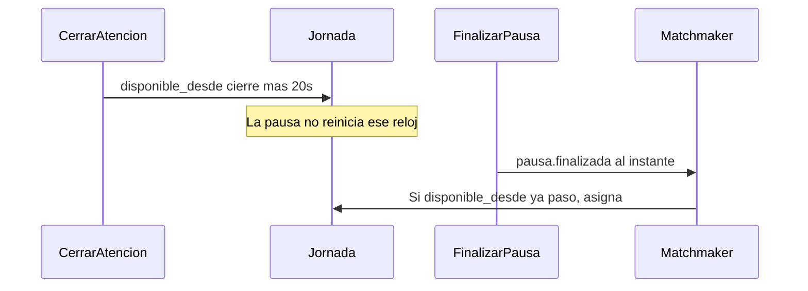

# Auditoría: gracia al volver de pausa

Fecha del caso: 28 de octubre de 2026.  
Fecha de la auditoría: 29 de octubre de 2026.  
Alcance: diagnóstico de solo lectura. No se modificó código, configuración ni datos operativos.

## Conclusión

El sistema hizo lo que hoy tiene codificado. Al volver de la pausa de comida, Lorenzo recibió el turno V-0071 a los 2 segundos. La espera de 20 segundos entre turnos no falló ni se perdió un job: esa espera solo se escribe al cerrar una atención y no se reinicia al finalizar una pausa.

La pausa de 178 minutos sí agotó la espera que quedaba del cierre anterior (unos 8 segundos). No existe una gracia nueva de retorno. Por eso una comida de varias horas deja a la persona elegible en el instante en que finaliza la pausa, si hay un turno en cola.

## Qué pasó

Persona: Lorenzo (`Lorenzo.Perez`, usuario 32), sucursal 1.  
Espera configurada en `pdv.turnos.plazos`: **20 segundos** (`cooldown_segundos`).  
Horarios en zona operativa de la sucursal (UTC−6).

| Hora | Hecho |
| --- | --- |
| 13:47:06 | Jornada 92 abierta. |
| 13:47:07 | Se asigna el turno 933. |
| 14:20:51 | Isaac cierra esa atención con motivo `venta` (evento 4367, atención 971). Eso escribe `disponible_desde` = cierre + 20 s, es decir **14:21:11**. |
| 14:21:03 | Isaac inicia la pausa, motivo **Comida** (intervalo 465, motivo 1). Quedaban unos 8 segundos de esa espera. La pausa no congela el reloj. |
| 17:16:48 | Entra a la cola el turno V-0071 (964), servicio ventas, mientras la pausa sigue abierta. |
| 17:19:23 | Lorenzo finaliza la pausa. Duración: **178 minutos**. La espera de las 14:21:11 ya había vencido hacía horas. |
| 17:19:25 | El matchmaker asigna V-0071 a Lorenzo. El evento 4483 guarda `origen: pausa.finalizada`, sin actor. Del fin de pausa a la asignación pasan **2 segundos**, no 20. La atención 1002 inicia en el mismo segundo. |
| 17:20:01 | Lorenzo cierra esa atención (`venta`). Sí queda `disponible_desde` = **17:20:21**. |
| 17:20:08 | La jornada queda cerrada. |

La marca `disponible_desde` que hoy conserva la jornada (17:20:21) corresponde al cierre de las 17:20:01, no al retorno de la pausa. El cierre de turno sigue respetando la espera.

## Por qué no hubo segundos de gracia

La espera vive en `pdv_jornadas.disponible_desde`. Solo la escribe `CerrarAtencionTurnoPdvService::aplicarCooldown` (`app/Services/PuntoVenta/Turnos/CerrarAtencionTurnoPdvService.php`). Con `cooldown_segundos` mayor que cero, guarda `ahora + cooldown_segundos` y programa un matchmaker diferido con origen `cooldown`. `ConsultaPersonaDisponiblePdvService` excluye a quien tenga esa marca en el futuro.

`FinalizarPausaPdvService` no toca `disponible_desde`. Cierra el intervalo `en_pausa`, abre uno `disponible` y dispara `PausaFinalizada`. `DespacharMatchmakerTrasPausaFinalizada` encola el matchmaker al momento, con origen `pausa.finalizada`. Ese origen es el que quedó en el evento 4483.

`IniciarPausaPdvService` tampoco congela ni reinicia la marca. El reloj de la espera anterior sigue corriendo mientras la persona está en pausa. Durante la pausa la pantalla muestra «Tiempo en pausa», porque el estado de pausa gana sobre «En espera» en `ResolverEstadoVendedorOperacionPdvService`. Al volver, si la marca ya venció, el estado pasa directo a disponible y el matchmaker puede asignar.

La duración larga no apaga una gracia de retorno: esa gracia no existe. Lo que sí hace una pausa de horas es agotar la espera del cierre anterior. El máximo permitido al guardar plazos es 3600 segundos. Con 20 segundos configurados, cualquier pausa mayor al resto pendiente deja a la persona elegible en cuanto vuelve.

Una pausa que hubiera terminado antes de las 14:21:11 sí habría respetado el resto de la espera del cierre de las 14:20:51. No habría creado una espera nueva.

El contrato actual lo afirma. Estos tests esperan disponibilidad y asignación inmediatas al finalizar la pausa:

- `test_pausa_real_bloquea_y_su_final_restablece_disponibilidad_permitida` en `tests/Feature/PuntoVenta/ContratoOperativoMedicionPdvTest.php`
- `test_finalizar_pausa_asigna_turno_en_cola_con_disponibilidad_real` en `tests/Feature/PuntoVenta/MatchmakerTurnosPdvTest.php`

## Huecos operativos

- Volver de pausa, abrir jornada y reactivar jornada dejan `disponible_desde` nulo o vencido y disparan el matchmaker al instante. Solo el cierre de atención aplica la espera.
- Iniciar una pausa no congela ni reinicia `disponible_desde`.
- La interfaz no anuncia una espera al salir de pausa, porque no hay marca futura que contar. El cronómetro «Espera para el siguiente turno» solo aparece si `disponible_desde` está en el futuro y la persona no está en pausa.
- El tope de 3600 segundos hace inevitable que una comida de varias horas venza cualquier espera previa.
- En este caso no intervino el bloqueo de unicidad del job (`uniqueFor` de 30 segundos). El evento de asignación cita `pausa.finalizada`, así que ese job sí corrió y asignó.

## Respuesta al caso

Se puede responder que el retorno se comportó según el código vigente. No hubo un fallo del temporizador de 20 segundos. Lorenzo quedó elegible porque la única espera vigente era la del cierre de las 14:20:51, y la pausa de comida la superó por mucho. Había un turno en cola desde las 17:16:48, así que el matchmaker de `pausa.finalizada` tuvo a quién asignar.

## Mejora sugerida

No implementada en esta auditoría.

Al finalizar la pausa, reutilizar `aplicarCooldown` para escribir `disponible_desde = ahora + cooldown_segundos` y programar el matchmaker diferido, igual que al cerrar una atención. El job inmediato de `pausa.finalizada` puede quedar: la consulta de disponibilidad saltará a esa persona hasta que venza la marca. La pantalla ya sabe mostrar «Espera para el siguiente turno» cuando esa marca está en el futuro.

Habría que ajustar los dos tests que hoy exigen asignación inmediata al salir de pausa.

No hace falta una regla especial por pausas largas. Conviene una espera nueva, del mismo parámetro que ya define gerencia, cada vez que alguien vuelve a estar disponible tras una pausa. Congelar solo los segundos que quedaban del cierre anterior no cubre este caso: aquí quedaban unos 8 segundos, y la expectativa reportada es poder acomodarse al regresar.

Abrir o reactivar la jornada tiene el mismo hueco (matchmaker inmediato y `disponible_desde` limpio). Esta sugerencia se limita al fin de pausa, que es el caso reportado.
