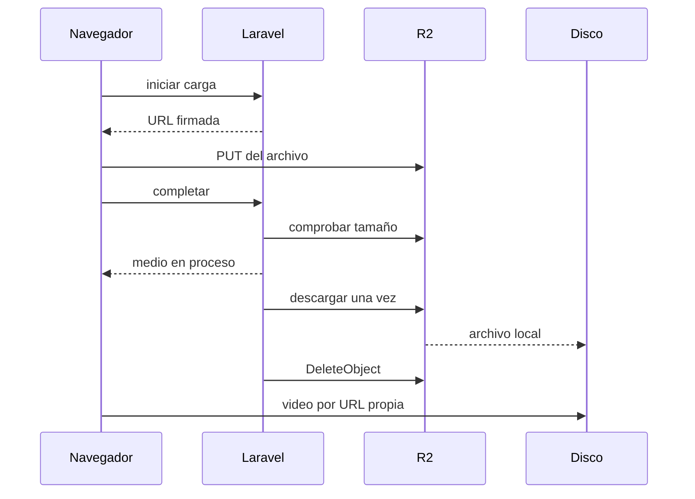

# Publicidad PDV: R2 solo como puente

Documento para desarrollo. No desplegar, no reiniciar contenedores, no correr la bajada contra el bucket de producción y no editar `update.sh` ni el `.env` de producción. El cambio se implementa y se prueba fuera de producción.

## Para qué

Cloudflare corta en 100 MB un POST que entra al origen por el proxy. Un video de publicidad puede pesar unos 800 MB. El navegador ya sube directo a R2 con URL firmada (una pieza, o trozos de 32 MB si pasa el umbral). Eso se queda igual.

Lo que hay que cambiar es el destino final. Hoy el objeto se queda en el bucket y la televisión lo pide a R2 en cada reproducción. R2 debe usarse solo para recibir el archivo. Este servidor lo descarga una vez, lo guarda en disco y borra el objeto del bucket. La pantalla reproduce la URL local.

## Cupo de 10 GB

Fuente: [tarifa de Cloudflare R2](https://developers.cloudflare.com/r2/pricing/). Aplica al almacenamiento Standard. Infrequent Access no entra en el free tier y tiene un mínimo de 30 días; este flujo usa Standard.

| Concepto | Gratis al mes | Qué pasa al borrar |
| --- | --- | --- |
| Almacenamiento | 10 GB-month | El espacio vuelve a quedar libre. Un video de 800 MB ocupa 0,8 GB mientras siga en el bucket. |
| Class A (escrituras: `PutObject`, `UploadPart`, `CreateMultipartUpload`, `CompleteMultipartUpload`, listados) | 1 millón | No se devuelve. Se acumula hasta el fin de mes. |
| Class B (lecturas: `GetObject`, `HeadObject`) | 10 millones | No se devuelve. La bajada del servidor es un `GetObject`. |
| `DeleteObject`, `AbortMultipartUpload` | Gratis | No consumen cupo. |
| Egress a internet | Gratis | Reproducir desde R2 no gasta los 10 GB. El límite que duele es el espacio ocupado. |

No es una bolsa de 10 GB de descarga. Borrar el objeto después de copiarlo al disco es lo que deja sitio para el siguiente archivo grande.

## Estado actual

1. El navegador pide `POST medios/cargas` ([routes/web/modules/medios.php](../routes/web/modules/medios.php)). [GestionarCargaMedioService::iniciar](../app/Services/Medios/GestionarCargaMedioService.php) abre la sesión en R2.
2. El navegador hace `PUT` directo al bucket ([resources/js/utils/medios/mediaUploader.js](../resources/js/utils/medios/mediaUploader.js)).
3. `completar` comprueba que el objeto existe y que el tamaño coincide, crea el `Medio` en `ready` y devuelve `urlLectura` de R2. No llama a `eliminar`.
4. [Publicidad/Index.jsx](../resources/js/Pages/PuntoVenta/Publicidad/Index.jsx) crea el anuncio enseguida con `medio_id`.
5. [PdvPantallaPublicidad::urlPublica](../app/Models/PuntoVenta/PdvPantallaPublicidad.php) usa R2 siempre que el medio esté `ready` y tenga `object_key`. El disco `public` (`pdv/pantalla-publicidad`) solo se usa si no hay medio listo.
6. Al quitar el último anuncio que apunta a un medio, [GestionarPublicidadPdvService::eliminar](../app/Services/PuntoVenta/Publicidad/GestionarPublicidadPdvService.php) marca el medio `deleted` y no borra el archivo.

## Comportamiento nuevo

- La subida firmada no cambia.
- `completar` sigue validando existencia y tamaño en R2. Si falla, el medio no se crea y R2 no se borra.
- El medio nace en `processing`, no en `ready`. La respuesta de `completar` no espera la bajada: un archivo de 800 MB no cabe en el tiempo del proxy.
- Un job encolado copia el objeto en streaming a `storage/app/public/pdv/pantalla-publicidad/{uuid}.{extension}`. No cargar el archivo entero en memoria.
- Si el tamaño en disco no coincide con `tamano_bytes`, el medio pasa a `failed` y el objeto de R2 se conserva.
- Si la copia coincide, se guarda la ruta local, el medio pasa a `ready` y entonces se llama `eliminar()` sobre la clave de R2. Si el borrado falla, se reintenta el job; no volver a dejar la reproducción apuntando a R2.
- `urlPublica()` devuelve la URL del disco `public` cuando hay ruta local. Sin ruta local no hay URL de reproducción, aunque exista `object_key`.
- La playlist ya descarta medios que no están `ready` ([ConsultaPlaylistPantallaSalaPdvService::reproducible](../app/Services/PuntoVenta/Pantallas/ConsultaPlaylistPantallaSalaPdvService.php)).
- La pantalla espera a que el medio esté `ready` antes de `punto_venta.publicidad.store`. [GestionarPublicidadPdvService::medioListo](../app/Services/PuntoVenta/Publicidad/GestionarPublicidadPdvService.php) ya rechaza un medio que no está `ready`. Hace falta una lectura de estado del medio (por `media_id`) para ese reintento. No crear el anuncio mientras sigue en `processing`.
- Al eliminar el anuncio, si ya no quedan filas con ese `medio_id`, además de marcar `deleted` se borra el archivo local. No dejar el archivo en disco.
- Los objetos que ya están en R2 no se migran en el deploy. Un comando Artisan, corrido a mano cuando se decida, copia cada medio `ready` que aún no tiene ruta local, verifica tamaño, guarda la ruta, borra el objeto y deja el medio `ready`. No registrarlo en el scheduler ni engancharlo a `update.sh`.

## Archivos a tocar

- Migración nueva: columna nullable `ruta_local` en `medios`. No reescribir `object_key`: esa columna sigue siendo la clave de R2 hasta que el job la borra del bucket.
- [app/Models/Medios/Medio.php](../app/Models/Medios/Medio.php): `ruta_local` en `$fillable`. `ESTADO_PROCESSING` ya existe.
- [app/Contracts/Medios/AlmacenObjetosMedio.php](../app/Contracts/Medios/AlmacenObjetosMedio.php): un método para volcar el objeto a una ruta absoluta en streaming (sin devolver el contenido en un string).
- [app/Services/Medios/AlmacenObjetosMedioR2.php](../app/Services/Medios/AlmacenObjetosMedioR2.php): implementar esa bajada con el cliente S3 (`GetObject` a archivo). `eliminar()` ya existe; usarlo solo después de la copia buena.
- [app/Services/Medios/AlmacenObjetosMedioFake.php](../app/Services/Medios/AlmacenObjetosMedioFake.php): la misma bajada contra un archivo temporal, para los tests.
- [app/Services/Medios/GestionarCargaMedioService.php](../app/Services/Medios/GestionarCargaMedioService.php): en `completar`, estado `processing`, despachar el job, no devolver URL de R2 como URL de reproducción.
- Job nuevo, mismo estilo que [app/Jobs/Mensajeria/ProcesarAdjuntoMensajeJob.php](../app/Jobs/Mensajeria/ProcesarAdjuntoMensajeJob.php) (`ShouldQueue`). Un intento fallido no borra R2.
- [app/Models/PuntoVenta/PdvPantallaPublicidad.php](../app/Models/PuntoVenta/PdvPantallaPublicidad.php): `urlPublica()` usa `Storage::disk('public')->url($medio->ruta_local)` cuando hay ruta local.
- [app/Services/PuntoVenta/Publicidad/GestionarPublicidadPdvService.php](../app/Services/PuntoVenta/Publicidad/GestionarPublicidadPdvService.php): al quedar sin referencias, borrar el archivo de `ruta_local`.
- Lectura de estado del medio para la UI, junto a las rutas de [routes/web/modules/medios.php](../routes/web/modules/medios.php).
- [resources/js/Pages/PuntoVenta/Publicidad/Index.jsx](../resources/js/Pages/PuntoVenta/Publicidad/Index.jsx): después de `subirMedioDirecto`, consultar el estado hasta `ready` o `failed` y solo entonces hacer el alta. Si falla, mostrar el error y no crear el anuncio.
- Comando Artisan manual para los medios viejos que siguen solo en R2. No ejecutarlo en este trabajo.
- Tests en [tests/Feature/PuntoVenta/PublicidadPdvTest.php](../tests/Feature/PuntoVenta/PublicidadPdvTest.php) (`test_carga_firmada_y_alta_de_publicidad`, `test_carga_multipart_cuando_supera_umbral`) y un caso del job: copia correcta borra el objeto falso; tamaño distinto deja el medio en `failed` y no borra R2. Con cola `sync` el job corre dentro del request de test; en entorno real la cola tiene que estar activa o el medio se queda en `processing`.

`pdv_pantalla_publicidades.ruta` puede seguir guardando la clave o la ruta local como dato de respaldo. La URL que ve la televisión sale de `urlPublica()`, no de asumir que `ruta` es una URL de R2.

## Qué no hacer

- No servir el video desde R2 después de tener `ruta_local`.
- No borrar el objeto de R2 antes de comprobar el tamaño en disco.
- No meter la bajada de 800 MB dentro del POST `completar`.
- No migrar solos los anuncios que ya están en el bucket.
- No tocar producción: ni contenedores, ni `update.sh`, ni `update-safe.sh`, ni el bucket real.
