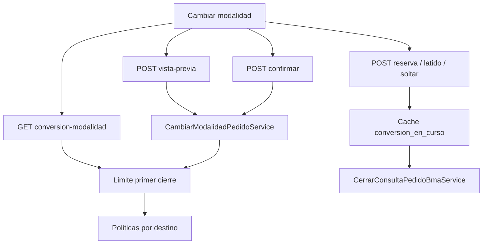

# M-02 — Motor compartido de conversión de modalidad

Plan aprobado. Copiado en Oleada 0 el 18 de noviembre de 2026. El contrato normativo para agentes posteriores es [`M02_CONTRATO_CONVERSION.md`](M02_CONTRATO_CONVERSION.md). Oleada 0 no implementa motor, UI ni pruebas.

**Goal:** Convertir un `PedidoBma` existente de Tienda a Envío municipal sin duplicar la compra, con un motor reutilizable para las seis direcciones.

**Architecture:** Orquestador `CambiarModalidadPedidoService` con límite **compartido** (primer cierre de consulta) y políticas **independientes por destino**. Persistencia en `solicitud_preparacion_json.conversion_modalidad`. Reserva de modal **por instancia** (adquisición atómica; no copiar [`RevisionEnCursoPedidoBma`](../app/Support/ControlPedidos/RevisionEnCursoPedidoBma.php)). P0 activa solo Tienda → Municipal.

**Tech stack:** Laravel 10 / PHP 8.2 (Sail), Inertia React, JSON operativo, `Cache::add`/`put`/`forget` (payload con `instancia_id`), [`PersistenciaAdjuntosConsulta`](../app/Services/ControlPedidos/PersistenciaAdjuntosConsulta.php) para evidencias, historial, PHPUnit + Vitest.

## Decisiones cerradas (no reabrir)

- Mismo registro `PedidoBma`. No crear folio. No usar [`RetirarCustodiaParaEnvioService`](../app/Services/ControlPedidos/RetirarCustodiaParaEnvioService.php) para fusionar con otro pedido.
- P0: Tienda → Municipal. P1: Municipal → Tienda. Futuro: direcciones con Nacional. P0 no implementa esas direcciones.
- **Límite del motor:** conversión solo **antes del primer cierre** de consulta. Una reapertura no recupera el permiso. Pago o remisión **no** vetan por sí mismos.
- Confirma la cuenta de Ventas propietaria del pedido con `control_pedidos.crear`, motivo y evidencia (o anotación de error de captura, patrón T-03). Sin permiso nuevo y sin gerencia para la conversión comercial. Autorizaciones físicas y financieras especiales siguen independientes.
- No relajar [`esEditablePorVendedora()`](../app/Models/ControlPedidos/PedidoBma.php) ni [`pedidoPagadoORemisionado()`](../app/Models/ControlPedidos/PedidoBma.php).
- No modificar exhibiciones, SAF ni PDFs de remisión al confirmar. El cargo nuevo se cubre después con los servicios de pago existentes.
- T-03 `pendiente_conexion`: conservar. Solo se **conecta** si el pedido sigue dentro del límite de cierre. Si ya hubo cierre, la intención histórica permanece visible y no autoriza apply.
- Políticas Tienda / Municipal / Nacional independientes. El límite de cierre vive en el motor, no copiado dentro de cada política de destino.

## 1. Diagnóstico real

Hoy **no hay apply**. T-03 solo escribe intención en [`MovimientosTiendaService`](../app/Services/ControlPedidos/MovimientosTiendaService.php) L101–110. [`TransferenciaTiendaTest::test_modalidad_solo_registra_intencion_sin_convertir_ni_liberar_custodia`](../tests/Feature/ControlPedidos/TransferenciaTiendaTest.php) afirma `modalidad_entrega === tienda`. Eso se conserva para Nacional y para Municipal **cuando el apply esté bloqueado por cierre**.

**Modalidad** vive en JSON (`tienda|municipal|nacional`). Gate municipal: [`ConsultaMunicipal::es()`](../app/Support/ControlPedidos/ConsultaMunicipal.php).

**Cierre de consulta (fuente del límite):**

- Columna `consulta_cerrada_at` / `consultaCerrada()` en [`PedidoBma`](../app/Models/ControlPedidos/PedidoBma.php).
- [`CerrarConsultaPedidoBmaService`](../app/Services/ControlPedidos/CerrarConsultaPedidoBmaService.php) escribe la columna y historial `AccionesHistorialPedidoBma::CIERRE_CONSULTA`.
- [`ReabrirConsultaPedidoBmaService`](../app/Services/ControlPedidos/ReabrirConsultaPedidoBmaService.php) **limpia** `consulta_cerrada_at` y no borra el historial.
- Helper del motor: `ConsultaPedidoYaCerradaAlgunaVez` = columna actual **o** existe historial `cierre_consulta` (tabla, no bitácora filtrada). Sin migración.

**Indicadores que no son el límite:** `folio_remision` (pedido Wizerp), `numero_remision`, PDF `tipo=remision`, `remision_tienda.emitida_at`, `pedidoPagadoORemisionado()`.

**Servicios que no sirven como apply:**

- [`RegistrarSolicitudMunicipalService`](../app/Services/ControlPedidos/Municipal/RegistrarSolicitudMunicipalService.php) L27: `esEditablePorVendedora` + `!pedidoPagadoORemisionado`. Extraer validación; **no** relajar el alta ordinaria.
- [`EnviarConsultaMunicipalService`](../app/Services/ControlPedidos/Municipal/EnviarConsultaMunicipalService.php) L26 mismo guard y L75 `unset(revision_disponibilidad)`. La conversión adopta o publica consulta por un colaborador interno (`PublicarConsultaMunicipal`) con contexto `conversion`; el alta M-01 no cambia.
- [`CambiarModalidadPreparacionService`](../app/Services/ControlPedidos/CambiarModalidadPreparacionService.php) no cambia `modalidad_entrega` y bloquea `cobertura_tienda`.
- Autoguardado: [`LimiteModalidadCapturaPedido`](../app/Support/ControlPedidos/RegistrarPedidos/LimiteModalidadCapturaPedido.php) + [`FusionarSolicitudPreparacionPedido`](../app/Services/ControlPedidos/FusionarSolicitudPreparacionPedido.php). Pinnear modalidad tras confirmar.

**No copiar [`RevisionEnCursoPedidoBma`](../app/Support/ControlPedidos/RevisionEnCursoPedidoBma.php):** `Cache::put` pisa al tenedor; la liberación solo compara `usuario_id` (otra pestaña de la misma cuenta robaba o soltaba la reserva). Solo sirve como referencia de TTL y de no usar tabla. M-02 implementa `ConversionModalidadEnCursoPedidoBma` con `Cache::add` (adquisición exclusiva, patrón [`MobileSyncPublicationService`](../app/Services/Mobile/MobileSyncPublicationService.php) L200), token de instancia, y soltar/renovar solo si coinciden `usuario_id` **e** `instancia_id`.

**Evidencias:** [`PersistenciaAdjuntosConsulta::guardar`/`limpiar`](../app/Services/ControlPedidos/PersistenciaAdjuntosConsulta.php) ya borra rutas si falla a mitad. T-03 [`SolicitarSegundoTrasladoTiendaService`](../app/Services/ControlPedidos/SolicitarSegundoTrasladoTiendaService.php) L75–82 guarda archivos **dentro** de la transacción **sin** limpieza: no copiar ese hueco. Reutilizar `guardar`/`limpiar`; no un segundo storage.

**Menú:** [`accionesPedidoLista`](../resources/js/Pages/ControlPedidos/Partials/pedidosListadoUi.js) es plano; «Cambiar modalidad» solo en custodia (T-03). M-02 lo ofrece con flags de backend, típicamente en consulta/preparación temprana.

**Cerrar consulta hoy:** [`PedidoBmaController::cerrarConsulta`](../app/Http/Controllers/ControlPedidos/PedidoBmaController.php) L1023 no envía modalidad ni versión. Tras convertir, un POST obsoleto caería en `cerrarMunicipal` porque `ConsultaMunicipal::es` ya sería true. Hay que exigir contexto esperado. UI: [`SeguimientoSolicitudTienda`](../resources/js/Pages/ControlPedidos/Partials/SeguimientoSolicitudTienda.jsx) / [`SeguimientoSolicitudMunicipal`](../resources/js/Pages/ControlPedidos/Municipal/SeguimientoSolicitudMunicipal.jsx) usan `puede_cerrar_consulta` y `motivo_bloqueo_cierre` ([`ListarPedidosBmaService::anexarFlagsVista`](../app/Services/ControlPedidos/ListarPedidosBmaService.php)). Refresco: [`PedidoBmaActualizado`](../app/Events/PedidoBmaActualizado.php) + [`useActualizacionesPedidos`](../resources/js/Pages/ControlPedidos/Partials/useActualizacionesPedidos.js) (`version_consulta` en [`LecturaFinancieraPedido`](../app/Support/ControlPedidos/LecturaFinancieraPedido.php) L17).

**Cobertura:** no construir motor de pagos. Overlay municipal en [`PoliticaFinancieraMunicipal`](../app/Services/ControlPedidos/Municipal/PoliticaFinancieraMunicipal.php). [`CalcularTotalesEnvioPedidoService`](../app/Services/ControlPedidos/CalcularTotalesEnvioPedidoService.php) trata `costo_envio` null como `'0.00'`; no rediseñar; el overlay distingue diferido.

## 2. Arquitectura



**Sin tabla nueva.** JSON `conversion_modalidad` + historial de pedido. Array `conversion_modalidad.historial[]` para conversiones anteriores; la vigente no las pisa.

**Políticas:** interfaz `PoliticaConversionModalidad` (`origenes`, `destino`, `activo`, `evaluar`). Dispatcher por **destino**. El orquestador aplica `ConsultaPedidoYaCerradaAlgunaVez` **antes** de la política. Municipal P0 `activo=true`. Tienda y Nacional `activo=false` (P1 / futuro), sin copiar la regla de cierre.

**Colaboradores del orquestador:** elegibilidad, reserva, herencia de consulta (3 casos), conciliación financiera, sustitución de instrucción abierta, persistencia, idempotencia.

## 3. Matriz de elegibilidad P0 (Tienda → Municipal)

**Límite compartido del motor (todas las direcciones, cuando se activen):**

- Consulta no iniciada u abierta: potencialmente permitida.
- Consulta respondida y **no** cerrada: permitida.
- `consulta_cerrada_at` actual: bloqueada.
- Historial con `cierre_consulta` (aunque hoy esté reabierta): bloqueada.
- Pago confirmado o remisión emitida: **no** añaden veto si el límite de cierre se cumple.

**Otros bloqueos del motor:** `modalidad_entrega !== tienda`; `cancelado_at` o fase `ENTREGADO`; actor no propietario o sin `crear`; destino no activo (Nacional / Municipal→Tienda visibles y `habilitado=false`).

**Política municipal P0:** no veta por pago ni remisión. No duplicar el chequeo de cierre (eso es del motor).

**T-03:** si `cambio_modalidad_tienda.pendiente_conexion` a municipal y el límite se cumple → `accion_ui=continuar` (misma conversión, no otra solicitud). Si el límite **no** se cumple → conservar la intención, `puede_iniciar=false`, `puede_continuar=false`, UI de seguimiento «pendiente de conexión», sin apply.

**Física (alcance reducido):** el cierre suele ocurrir antes de custodia/T-02, así que custodia queda **fuera del camino feliz**. Prioridad: consulta y preparación tempranas.

- CEDIS / consulta temprana: sin movimiento físico; si hay tarea Tienda abierta, sustituirla (una sola instrucción vigente).
- Preparación Tienda con instrucción abierta: sustituir a `ENVIO_MUNICIPIO` o marcar la anterior `SUSTITUIDA`. Nunca dos abiertas ([`InstruccionEntrega`](../app/Support/ControlPedidos/InstruccionEntrega.php)).
- Custodia o tránsito **con consulta aún abierta** (excepción): conversión comercial sí; `entrega_bloqueada=true`; `estatus_sucursal` intacto; sin salida/recepción/retiro ficticios. Adecuación física = operación posterior autorizada (no sistema nuevo).
- Custodia con consulta ya cerrada: no convertir (límite del motor). T-03 histórico se conserva.

**Estado al confirmar (explícito):**

- `catalogo_estatus_pedido_id`: no avanzar a fases de pago/remisión/entrega. Conservar BORRADOR / PESAJE_PENDIENTE / PESAJE_RESPONDIDO. No inventar transición.
- `estatus_envio`: no marcar empacado ni consolidado. Si era `pendiente_pesaje` de consulta CEDIS, no reescribirlo como hecho físico. Diferido municipal puede setear `pendiente_regularizacion` **solo** como lo hace el alta M-01 de costo diferido.
- Tarea vigente: a lo sumo una; la de Tienda abierta se sustituye. Cumplimiento físico de la anterior queda en historial de tarea.
- `cobertura_tienda`: se conserva como hecho de cobro de mercancía; no se borra.
- `sucursal_destino_id`, resguardos, `numero_remision`, documentos: no se tocan.

## 4. Herencia de consulta (tres casos)

Metadatos explícitos en `consulta_municipal`: `procedencia` (`nueva` | `heredada_parcial` | `heredada_completa`), `consulta_origen` (`tienda` | `cedis` | `ninguna`), `almacen_id`, `heredada_en` / `heredada_por_id`. **Nunca** `unset` de `revision_disponibilidad` en estos caminos.

- **Sin consulta previa:** no hay `revision_disponibilidad` ni envío. Tras confirmar, el orquestador deja el circuito municipal listo para **iniciar** consulta con `PublicarConsultaMunicipal` en contexto `conversion` (no pasa por los guards de alta pagada de `EnviarConsultaMunicipalService`). No inventar `enviada_at` ni respuesta.
- **Consulta parcial:** hay respuesta incompleta, excepciones, anexos/retiros pendientes, o almacén destino distinto. Conservar evidencia y unidades. Estado `excepciones_pendientes`. `requiere_revision_complementaria=true`. No declarar cerrada ni aprobada.
- **Consulta respondida y abierta:** reutilizar íntegra. Copiar `enviada_at` original si existía (o el de la solicitud Tienda). `ConsultaMunicipal::estado` deriva de la revisión vigente. **No** copiar `consulta_cerrada_at` (si estuviera cerrada, el motor ya habría bloqueado). El cierre posterior es el cierre municipal normal de Ventas.

M-01 ordinario sigue exigiendo no pagado/remisionado para **registrar** solicitud municipal nueva. La conversión no llama ese service como apply.

Tras convertir, `PoliticaFinancieraMunicipal` sigue exigiendo consulta **cerrada** para nuevas exhibiciones. Si la heredada está abierta, el UI lo indica; no se relaja la barrera.

## 5. Contrato técnico

Rutas en [`routes/web/modules/control-pedidos/core.php`](../routes/web/modules/control-pedidos/core.php):

- `GET .../conversion-modalidad`
- `POST .../conversion-modalidad/vista-previa`
- `POST .../conversion-modalidad` confirmar
- `POST .../conversion-modalidad/cancelar` (borrador / T-03 no conectada; no deshace confirmada)
- `POST .../conversion-modalidad/reserva` abrir (`instancia_id` obligatorio)
- `POST .../conversion-modalidad/reserva/latido` renovar el mismo `instancia_id`
- `DELETE .../conversion-modalidad/reserva` soltar esa instancia

Permiso: `control_pedidos.crear` + `puedeMutarComoVendedora`.

**Orden de bloqueo (invariante, cierre y conversión):** siempre `lockForUpdate` del pedido **antes** de leer o escribir la reserva en caché. Nunca caché-luego-fila.

**Reserva (`ConversionModalidadEnCursoPedidoBma`) — no clonar auditoría:**

- Clave: `pedido_bma.conversion_en_curso.{pedidoId}`. Payload: `{ usuario_id, instancia_id, at }`. TTL **45 s**. Heartbeat 15–20 s.
- El cliente genera `instancia_id` (UUID) al abrir el modal. Dos pestañas de la misma cuenta = dos instancias; la segunda recibe 409.
- **Adquirir (atómico):** tras `lockForUpdate` y chequeo de elegibilidad, `Cache::add(...)`. Si existe otra instancia → 409 «Hay un cambio de modalidad en curso». Si es la misma instancia → renovar. No usar `Cache::put` para adquirir.
- **Renovar:** leer payload; solo `Cache::put` + TTL si `usuario_id` e `instancia_id` coinciden. Si caducó, reintentar `add` (misma instancia, pedido aún elegible).
- **Liberar:** solo el propietario (`usuario_id` + `instancia_id`). Otro token no hace `forget`.
- **Caducidad:** sin latido el TTL borra la clave. Sin tabla, Redis extra ni cola.
- Broadcast `PedidoBmaActualizado` `accion` = `conversion_reserva_adquirida` | `conversion_reserva_liberada` | `conversion_modalidad` (confirmar). Listado: `puede_cerrar_consulta=false` + `motivo_bloqueo_cierre` + `reserva_instancia` opaca (no filtrar solo por React local).

**Cierre de consulta — contexto esperado (Agente A en `CerrarConsultaPedidoBmaService` + `cerrarConsulta`):**

Tras `lockForUpdate`:

1. Reserva activa → 422 cambio de modalidad en curso.
2. Si el request trae `modalidad_esperada` y no coincide con `modalidad_entrega` actual → 409 `contexto_obsoleto` (p. ej. ya es municipal).
3. Si trae `version_consulta` y no coincide con `historial()->max('id')` → 409 vista atrasada.
4. Recién entonces el cierre existente.

El frontend **siempre** envía `modalidad_esperada` y `version_consulta`. Los POST M-01 sin esos campos siguen cerrando **solo** si no hubo conversión (compatibilidad). Tras confirmar conversión, un cierre Tienda obsoleto se rechaza aunque omita campos: si `conversion_modalidad.estado=confirmada` y no vino `modalidad_esperada=municipal`, 409 y la UI pasa al seguimiento municipal.

**Evidencias (fallo parcial):** no basta «guardar dentro del `DB::transaction`». El rollback de SQL no borra el disco. Flujo:

1. `lockForUpdate` + validaciones (sin archivos aún).
2. [`PersistenciaAdjuntosConsulta::guardar`](../app/Services/ControlPedidos/PersistenciaAdjuntosConsulta.php) (`relacion_tipo=conversion_peticion_cliente`).
3. Resto de la transacción.
4. `catch`: `limpiar($rutas)` **aunque** el rollback ya deshizo las filas.
5. `guardar` ya limpia si falla a mitad de archivos.

No copiar el store crudo de T-03. No nuevo servicio de storage.

**Confirmación (orden fijo):**

1. `lockForUpdate`.
2. **Idempotencia primero:** `clave_idempotencia` ya confirmada → devolver resultado aunque la versión esté atrasada.
3. Reserva de esta `instancia_id` (o caducada y el pedido sigue elegible).
4. Límite de primer cierre + política destino + permiso + `conversion_version`.
5. Validar captura municipal extraída.
6. Evidencias con limpieza compensatoria (arriba).
7. Escribir modalidad municipal, expediente, finanzas, `costo_envio` (null si diferido), `total_a_cobrar`.
8. Tres casos de consulta. `revision_disponibilidad` intacta.
9. Sustituir instrucción Tienda abierta si existe. Custodia excepcional: solo `entrega_bloqueada`.
10. Conectar T-03 municipal solo si el apply procedió.
11. Empujar snapshot a `historial[]`; vigente `confirmada`.
12. Incrementar `revision_registro` y `conversion_version`.
13. Historial «Cambio a envío municipal». Soltar reserva de esta instancia. Broadcast `conversion_modalidad`.

**Request confirmar P0:** `destino=municipal`, `instancia_id`, motivo, evidencias u `error_captura`, campos M-01, `revision_esperada`, `conversion_version`, `clave_idempotencia`.

**Flags GET / listado:**

```
conversion_modalidad: {
  origen,
  destinos: [{ codigo, nombre, habilitado, motivo_bloqueo }],
  puede_iniciar, puede_continuar, puede_cancelar_borrador,
  consulta_ya_cerrada_alguna_vez,
  reserva_activa, reserva_usuario_id,

  solicitud_pendiente: { fuente, estado },
  herencia: { caso: sin_consulta|parcial|respondida_abierta, consulta, pagos, remision, documentos },
  finanzas: { mercancia, pagado, costo_envio_actual, costo_envio_nuevo, pendiente_transporte, transporte_desconocido, validacion_historica_no_cubre_nuevo_cargo },
  fisica: { condicion, pendiente, mensaje },
  version
}
```

Autoguardado tras confirmar: 409 por revisión; Fusionar pinnea `modalidad_entrega` si hay conversión confirmada.

## 6. Cambios por capa (un propietario por archivo)

**Nuevos — Agente A:** `app/Support/ControlPedidos/Conversion/*` (políticas, DTO, `ConsultaPedidoYaCerradaAlgunaVez`, `ConversionModalidadEnCursoPedidoBma`); `app/Services/ControlPedidos/Conversion/*` (orquestador, herencia, finanzas, persistir, `PublicarConsultaMunicipal`); `ValidarCapturaMunicipal`; controller de conversión + requests.

**Agente A también edita (único dueño en oleada 1):** `core.php`; Fusionar (conservar + pin); `CerrarConsultaPedidoBmaService` (reserva + contexto); `PedidoBmaController::cerrarConsulta` (aceptar `modalidad_esperada`, `version_consulta`; no reescribir el resto del controller); `ListarPedidosBmaService` (flags + motivo cierre); `AccionesHistorialPedidoBma`; `PedidoBma::motivoBloqueoEntregaTienda` (adecuación excepcional); `MovimientosTiendaService` rama municipal; `EnviarConsultaMunicipalService` solo skip unset si `heredada`+`enviada_at`; `RegistrarSolicitudMunicipalService` solo delegar validación. **Usa** `PersistenciaAdjuntosConsulta` sin modificarlo.

**Agente B (no PHP):** `pedidosListadoUi.js`, `TablaPedidos.jsx`, `Index.jsx`, `ModalMovimientosTienda.jsx`, `FormularioRegistrarMunicipal.jsx` (callback / `modo=conversion`), `SeguimientoSolicitudTienda.jsx` y `SeguimientoSolicitudMunicipal.jsx` (enviar contexto al cerrar; deshabilitar con motivo de reserva), `useActualizacionesPedidos.js` (acciones de reserva/conversión), `ModalConversionModalidad.jsx` nuevo, tests jsx nuevos.

**Agente C:** solo `tests/Feature/ControlPedidos/ConversionModalidadM02Test.php` y tests frontend **nuevos** de conversión. No producción. No editar suites M-01 / Tienda / T-03.

**Agente D:** solo lectura.

**No tocar:** fórmula canónica de cobertura, `RetirarCustodiaParaEnvioService`, `PersistenciaAdjuntosConsulta.php`, Nacional legado, migraciones, `esEditablePorVendedora`. Sin push. Sin M-03 ni Municipal→Tienda ni Nacional en P0.

**Migraciones:** ninguna. Evidencias vía `PersistenciaAdjuntosConsulta` + `relacion_tipo=conversion_peticion_cliente`.

## 7. Interfaz y menú

Grupos en `accionesPedidoLista`. [`MenuAccionesPedido`](../resources/js/Pages/ControlPedidos/Partials/TablaPedidos.jsx) pinta encabezados; teclado y 44px se conservan.

- Consulta y seguimiento: Ver detalle, Bitácora
- Operaciones: Continuar/Editar, Cambiar modalidad, Solicitar traslado, …
- Administración: Cancelar, Eliminar registro

«Cambiar modalidad» si `puede_iniciar || puede_continuar`. No exigir `en_custodia`. Destinos inactivos visibles y deshabilitados.

Wizard: origen → Municipal → herencia (los 3 casos) → formulario municipal real precargado → finanzas (solo pendiente real) + física si aplica → motivo/evidencia → resultado y seguimiento municipal.

Al abrir: UUID `instancia_id` + `POST reserva`. Latido con el mismo id. Al cerrar/cancelar/`beforeunload`: `DELETE reserva` de esa instancia. Captura sucia: sessionStorage municipal + confirmación. Eventos `conversion_reserva_*` y `conversion_modalidad` refrescan cierre y seguimiento en otras sesiones. El POST de cerrar consulta envía `modalidad_esperada` y `version_consulta`; 409 `contexto_obsoleto` abre el seguimiento municipal.

## 8. Integración (consulta, pagos, custodia)

**Pagos:** reutilizar [`CoberturaPagoPedidoBmaService`](../app/Services/SaldosAFavor/CoberturaPagoPedidoBmaService.php), [`RegistrarPagoPedidoBmaService`](../app/Services/SaldosAFavor/RegistrarPagoPedidoBmaService.php), Importes. Recalcular cobertura efectiva. Mostrar solo el pendiente de **nuevos** cargos. Una validación histórica de mercancía **no** cubre transporte nuevo. Conciliar `pendiente = max(0, nuevo_envio_conocido - envio_ya_reconocido_en_cobertura)`. Diferido: `null`, no cubierto, no cero. No usar `AnexarPagoEnvio` para este cargo (es anexo diferido/resguardos). Bloqueos de operación que exigen cobertura completa se respetan (no se relajan porque «ya estaba pagado»).

**Consulta:** ver sección 4. CEDIS/Tienda responden por `AlcanceConsultaMunicipal` cuando el envelope municipal existe.

**Custodia:** camino excepcional y mínimo (`entrega_bloqueada`). Sin motor físico nuevo.

## 9–10. Oleadas y Build in Parallel

**Regla:** un propietario por archivo en cada oleada. Si hay que tocar el de otro, el coordinador serializa. Worktrees cuando dos frentes no pueden esperar. No iniciar trabajo dependiente sin contrato. No forzar paralelo donde el acoplamiento obliga secuencia. Sin push.

### Oleada 0 — Coordinador (secuencial, bloquea el paralelo)

Congelar [`gestion-pedidos-docs/M02_CONTRATO_CONVERSION.md`](M02_CONTRATO_CONVERSION.md) y copiar este plan a [`gestion-pedidos-docs/M02_PLAN_CONVERSION_MODALIDAD.md`](M02_PLAN_CONVERSION_MODALIDAD.md):

- Límite de primer cierre; políticas por destino; 3 casos de consulta.
- Reserva: `instancia_id`, `Cache::add`, TTL, mensajes 409, orden lock fila → caché, acciones de broadcast.
- Cierre: `modalidad_esperada` + `version_consulta`; 409 `contexto_obsoleto`.
- Evidencias: `guardar`/`limpiar`; no T-03 crudo.
- Shape GET/POST; orden de idempotencia.
- Matriz de archivos autorizados / prohibidos por agente.

Interfaces PHP + DTO vacíos en `Conversion/`. **Nadie más los cambia después** (nombres, firmas, constantes y claves JSON). Agente A rellena cuerpos que lanzan `LogicException`.

### Oleada 1 — Build in Parallel (A+B+C+D)

A incluye herencia, finanzas, reserva, gate de cierre y evidencias. **No** se reprograman en la oleada 2.

**Agente A — dominio/backend**
- Objetivo: motor, políticas, reserva atómica, cierre con contexto, persistencia, concurrencia, API.
- Depende de: contrato oleada 0.
- Edita: lista de la sección 6 (PHP). **No** JSX. **No** tests de C. **No** `PersistenciaAdjuntosConsulta.php`.
- Entregable: endpoints verdes contra el contrato; PHPUnit propio de motor (no el archivo de C).
- Done: confirmar/cancelar/reserva; cierre obsoleto 409; T-03 conecta solo si elegible; archivos huérfanos no quedan tras rollback.

**Agente B — frontend**
- Objetivo: menú agrupado, wizard, reuso municipal, sync entre sesiones.
- Depende de: contrato (mocks). No espera el PHP de A.
- Edita: lista JSX de la sección 6. **No** servicios PHP.
- Entregable: `instancia_id` + latido; cierre deshabilitado por flags; POST cerrar con `modalidad_esperada` y `version_consulta`; 409 refresca a municipal; tests jsx propios.
- Si un test colocalizado de Seguimiento falla solo por campos extra en el POST, lo ajusta B (dueño del archivo) sin cambiar aserciones de negocio M-01.
- Done: a11y del menú; captura sucia protegida; T-03 municipal continúa o se consulta.

**Agente C — pruebas (archivos propios)**
- Objetivo: casos de la sección 11 + regresiones **declaradas** contra el contrato (fallan hasta integrar A).
- Edita: `ConversionModalidadM02Test.php` y `*.conversion.test.jsx` nuevos.
- **No** producción. **No** `MunicipalOrdinarioM01Test`, `SolicitudRegistrarTiendaTest`, `TransferenciaTiendaTest`.
- Done: cada caso afirma la condición (cierre histórico, herencia, pagos, reserva entre instancias, carrera cierre/conversión).

**Agente D — auditoría solo lectura**
- Objetivo: consulta, finanzas, custodia, T-03, reserva vs auditoría, evidencias, regresiones.
- Edita: nada. Informe de hallazgos al coordinador.

### Oleada 2 — Integración (coordinador)

Conectar wizard a API real, correr tests de C contra A, unificar mensajes, verificar broadcast y TTL. Corregir incompatibilidades de contrato. **No repetir** reserva, herencia ni menú. D relee. Un solo integrador; worktree o cola si hay que retocar un archivo de A o B.

### Oleada 3 — Regresión

Sail con el filtro de la sección 11. Comprobar en concreto: primer cierre histórico; consulta heredada intacta; pagos/documentos intactos; transporte = solo saldo nuevo; reserva entre sesiones; una instrucción vigente; Nacional sin activar. Docs módulo. **Informe consolidado** (entrega final): funcionalidades; cambios por agente; resultado de pruebas; conflictos y resolución; pendientes reales; confirmación explícita de que Tienda 3.1 y Municipal M-01 siguen verdes. Sin push. Sin `migrate:fresh`. Sin `ALLOW_DESTRUCTIVE_DB`.

**Ruta crítica:** Oleada 0 → A (motor+reserva+cierre) → oleada 2 → oleada 3. B y C en paralelo desde el contrato. E2E UI espera A.

## 11. Criterios de aceptación y pruebas

Comando:

`./vendor/bin/sail exec -e APP_CONFIG_CACHE=/tmp/gelia-test-config.php -e APP_ROUTES_CACHE=/tmp/gelia-test-routes.php laravel.test php artisan test --filter='ConversionModalidadM02Test|MunicipalOrdinarioM01Test|SolicitudRegistrarTiendaTest|TransferenciaTiendaTest|ImportesPagoTiendaTest|RemisionAuditoriaTest|InstruccionEntregaVigenteTest|RecorridoTiendaIntegralTest|ConcurrenciaCapturaPedidoTest'`

Frontend: listado grupos, ModalConversion, heartbeat/reserva (mock), registroMunicipal, ModalMovimientosTienda.

**Casos P0 (afirmar la condición):**

1. Consulta no iniciada → convierte; mismo id/folio; circuito destino listo para iniciar consulta.
2. Consulta parcial → conserva evidencia; pide complementaria; no cierra.
3. Consulta respondida y abierta → hereda `revision_disponibilidad`; `procedencia=heredada_completa`.
4. Consulta cerrada → 422; no cambia modalidad.
5. Cerrada y reabierta (`consulta_cerrada_at` null + historial `cierre_consulta`) → 422.
6. Pago confirmado con consulta abierta → convierte; pagos intactos; pendiente = nuevo cargo.
7. Remisión emitida con consulta abierta → convierte; remisión intacta.
8. Solo `folio_remision` → no se trata como cierre ni como remisión bloqueante.
9. Transporte diferido → `costo_envio=null`; no cubierto; no cero.
10. Nueva exhibición cubre solo el pendiente; validación histórica no lo cubre sola.
11. Anexos/retiros pendientes → caso parcial; no aprueba por inferencia.
12. CEDIS / preparación temprana → sin segundo pedido; una instrucción vigente.
13. Custodia con consulta **abierta** (excepción) → convierte; `entrega_bloqueada`; sin salida ficticia. Custodia con consulta cerrada → bloqueada por límite.
14. Abrir modal → `Cache::add` con `instancia_id`; `puede_cerrar_consulta=false` en cualquier sesión; broadcast adquirir.
15. Segunda instancia (otra cuenta u otra pestaña) → 409; no pisa la reserva.
16. Latido de un token ajeno no renueva; soltar ajeno no libera.
17. Otra persona POST cerrar-consulta con reserva activa → 422 cambio en curso (aunque envíe versión actual).
18. Confirmar conversión → broadcast; la otra sesión refresca a municipal; un cierre Tienda posterior (con o sin campos viejos) → 409 `contexto_obsoleto`.
19. Cerrar/cancelar modal de **esa** instancia → reserva liberada; cierre vuelve si sigue elegible.
20. Sin latido hasta TTL → caduca; sin bloqueo permanente; se puede adquirir de nuevo si sigue elegible.
21. Confirmación y cierre concurrentes, mismo orden de lock: si cierra primero, conversión se rechaza por límite; si convierte primero, el cierre con contexto Tienda se rechaza.
22. Fallo a mitad de evidencias o rollback SQL → `limpiar` borra archivos; no quedan huérfanos ni filas.
23. Reintento misma `clave_idempotencia` con versión atrasada → recupera el resultado, no 409 de versión, no duplica.
24. Dos confirmaciones distintas concurrentes → una persiste; la otra 409 o idempotente.
25. Autoguardado/PATCH obsoleto tras confirmar → 409; modalidad municipal pinneada.
26. T-03 `pendiente_conexion` con consulta abierta → continuar, no duplicar. Con consulta ya cerrada → se conserva, no apply.
27. Permisos 403; historial de conversión no pisa el anterior.
28. Regresión Tienda 3.1 + T-03 Nacional sigue pending.
29. Regresión M-01: alta ordinaria sigue bloqueando pagado/remisionado; cierre sin campos nuevos sigue válido **si no hubo conversión**.

SQLite no acredita lock MySQL; 21–24 afirman versión/idempotencia/`Cache::add`. Verificación UI con build publicado, sin `public/hot`.

## 12. Riesgos, bloqueos, cierre

- Reapertura limpia `consulta_cerrada_at`: el límite **debe** leer historial `cierre_consulta`. Test 5 no negociable.
- `EnviarConsultaMunicipal` no inicia consulta de un pedido pagado: contexto `conversion` de `PublicarConsultaMunicipal` para casos 1+6 **sin** relajar M-01.
- `RevisionEnCursoPedidoBma` **no** es la reserva. Copiarla reintroduce carrera entre pestañas.
- Cierre M-01 sin `modalidad_esperada` debe seguir pasando **hasta** que exista conversión confirmada; después el 409 es obligatorio (test 18).
- Evidencias: rollback SQL ≠ disco. Test 22.
- Cache array en PHPUnit; en servidor el store de la app. Vaciar caché en deploy suelta la reserva (aceptable).
- `CalcularTotalesEnvio` null→0.00: overlay municipal; no rediseñar.
- Formulario municipal en conversión **debe** usar el callback.
- Custodia masiva fuera por el límite de cierre.

**P0 done cuando:** Tienda→Municipal confirma el mismo pedido solo si nunca se cerró la consulta; reserva exclusiva por instancia y caduca; cierre obsoleto 409; 3 casos de consulta; pagos/remisión intactos y pendiente real; menú agrupado con flags de servidor; T-03 no aplica si hubo cierre; suites 28–29 verdes; informe consolidado de oleada 3; sin tabla ni permiso nuevos; sin push.

**Fuera de P0:** Municipal→Tienda, Nacional, retiro físico completo, P-01, carátula definitiva, M-03/M-04.

## Global constraints

- Sail para PHP/npm/test. PHP 8.2. Sin dependencias nuevas.
- Sin `ALLOW_DESTRUCTIVE_DB`, sin `migrate:fresh`, sin datos reales, sin push automático.
- Sin ampliar a M-03, Municipal → Tienda o Nacional en P0.
- Texto de UI en género neutro. Sin códigos de ficha en botones («Cambiar modalidad», «Envío municipal»).
- GUIA_DISENO_GELIA; reusar `FormularioRegistrarMunicipal`.
